# Pi Crust

A desktop app for [Pi](https://pi.dev): your repo, your running app and a chat with Pi in one window.

Pi Crust runs on macOS and Windows 11. Read how and why it was designed in the case study at [nullvorm.com/pi-crust](https://nullvorm.com/pi-crust).

<picture><source media="(prefers-color-scheme: dark)" srcset="docs/screenshots/hero-dark.png">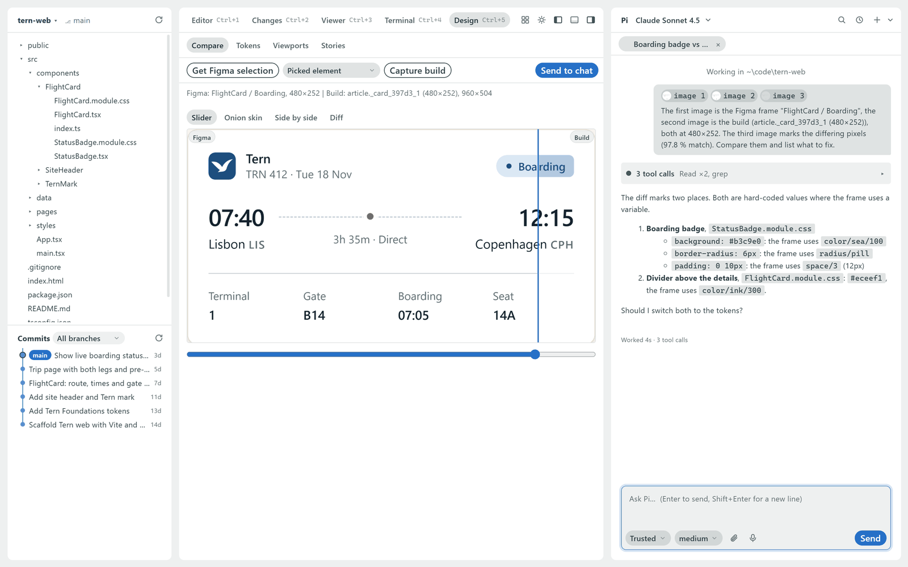</picture>

<picture><source media="(prefers-color-scheme: dark)" srcset="docs/screenshots/editor-dark.png">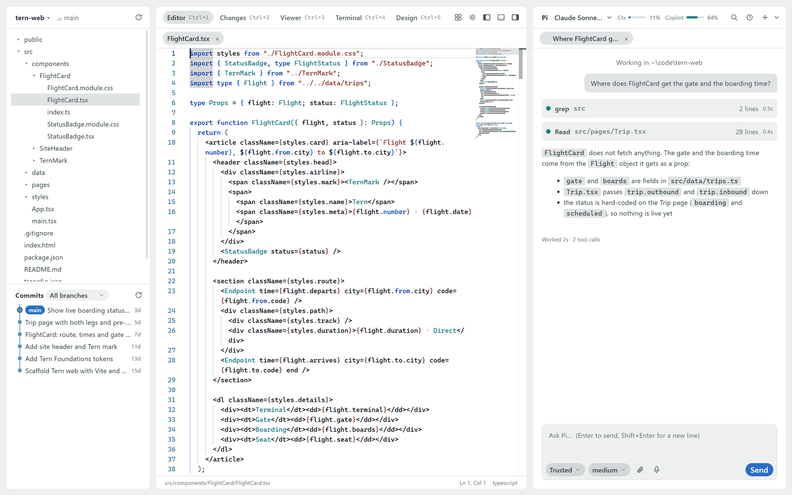</picture>

| Left | Middle | Right |
|---|---|---|
| File tree with git status and the commit graph | Editor, Changes, Viewer, Terminal and Design tabs | Chat with Pi, one tab per chat |

Pi runs as a subprocess in RPC mode (`pi --mode rpc`), so everything in `~/.pi/agent` keeps working: the model, subagents, extensions, skills, MCP servers and the Copilot usage status.

Pi is the default agent. You can also start a chat with a second, optional agent, **Claude Agent** (powered by Claude). It needs your own Anthropic API key. See [Claude Agent](#claude-agent-optional).

The layout and some ideas (startup probe, process-group shutdown, tool cards, prompt recall) were inspired by [Pi Desktop](https://github.com/FaqFirebase/pi-desktop). No code was copied.

## Contents

- [Quick start](#quick-start)
- [Chat](#chat)
- [Claude Agent (optional)](#claude-agent-optional)
- [Views](#views)
- [Middle tabs](#middle-tabs)
- [Design tab](#design-tab)
- [Working in the browser](#working-in-the-browser)
- [History: checkpoints, rewind and screenshots](#history-checkpoints-rewind-and-screenshots)
- [Worktree per chat](#worktree-per-chat)
- [Keyboard shortcuts](#keyboard-shortcuts)
- [Remote from your phone](#remote-from-your-phone)
- [Configuration](#configuration)
- [Development](#development)

## Quick start

See [SETUP.md](SETUP.md) to install, for macOS and Windows. To get the latest version later, press **Update** when *Pi Crust update available* shows in the notifications above the chat, or run `npm run update` in this folder (see [SETUP.md](SETUP.md#update)). To start:

**macOS**

```bash
pi-crust                 # shows the repo picker (or reopens the last repo)
pi-crust ~/some/repo     # opens that repository
```

You can also open **Pi Crust** from Applications (Spotlight or the Dock) after installing it as an app with `npm run update -- --app` ([SETUP.md](SETUP.md#install-as-an-app-macos)), or run `npm start` in this folder. Logs go to `~/Library/Logs/pi-crust.log`.

**Windows**

Download `Pi-Crust-Setup-<version>.exe` from the [Releases page](https://github.com/PimDieks/Pi-Crust/releases) and run it. To build the installer from a clone instead, run `npm run dist:win` (it writes `dist\Pi-Crust-Setup-<version>.exe`).

The installer installs for your user only (no admin) and adds Start Menu and desktop shortcuts and an uninstall entry. The installer is not signed, so SmartScreen asks: choose More info, then Run anyway.

An app installed from a release updates itself: about 15 seconds after start, and then every hour, **Pi Crust update available** shows in the notifications. **Update** downloads it, **Restart now** installs it (or it installs when you quit), and **Release notes** opens that release on GitHub. Updates only go forward. To **go back to a previous version**, download the older installer from the [Releases page](https://github.com/PimDieks/Pi-Crust/releases) and run it over the current one: your settings and chats stay.

**First launch.** Pi Crust opens a setup checklist: Pi, a model provider, Git and a project folder, with one button for each. It can install what is missing after you confirm a list of exactly what will be installed, and then a short guided task shows the loop of ask, change and undo. You can skip it; a **Setup** pill stays in the chat header until the required lines are done, and `/setup`, the command palette and the **Help** menu bring it back. See [docs/day-1.md](docs/day-1.md).

Then open **Pi Crust** from the Start Menu, or use the launcher in a terminal (cmd or PowerShell):

```powershell
pi-crust                 # shows the repo picker (or reopens the last repo)
pi-crust C:\path\to\repo   # opens that repository
```

The `pi-crust.cmd` launcher prefers the installed app. `npm start` also works from this folder. Logs go to `%LOCALAPPDATA%\pi-crust\logs`, one log per launch. For prerequisites and the steps to run from source, see the Windows section of [SETUP.md](SETUP.md#windows).

**Docker (Linux container, used in your browser)**

```bash
PROJECTS=~/Documents WORKSPACE=~/Documents/some-repo docker compose -f docker/compose.yml up --build -d
```

Then open http://localhost:6080/. Logins, full screen, clipboard and reaching services on your computer: see [docker/README.md](docker/README.md).

## Chat

**Basics**
- Enter sends, Shift+Enter adds a new line, Up/Down recalls earlier prompts, Esc or **Stop** aborts.
- A message sent while Pi works is queued as steering.
- Pi's questions (permission prompts, the `question` tool, confirmations) appear in a panel above the input, not as a popup. Esc cancels.

**Chat tabs.** Every chat is its own Pi process, so several chats run in parallel and keep working in the background.
- **＋**, ⌘N, `/new` or *New chat* in the palette opens a new tab; the current chat is never wiped.
- A tab shows ✻ while it works (with its elapsed time), ● when it finished in the background and **?** when it waits for an answer.
- Each tab keeps its own draft, model, thinking level and permission mode.
- **Earlier chats** (⌘J) reopens a saved chat in a new tab.

**Tool cards and progress**
- Tool calls show as cards with a live timer; edits show a diff.
- **Subagent** cards show each agent live: model, status, elapsed time, tool calls, result, and "step X of N" (chain) or "N of M done" (parallel).
- While Pi works the status line shows the turn time, tool count and last tool. When it is done: "Worked 3m 05s · 12 tool calls".

**Composer controls**

| Control | What it does |
|---|---|
| Permission mode | Plan (read-only), Ask before edits, Ask before commands, Trusted. See **Permission modes** below. |
| Thinking level | The select next to it (also `/thinking`). |
| `@` mentions | Type `@` for files and folders; Tab / Enter inserts `` `path` ``. |
| Voice input | Mic button or ⌘⇧Space records; press again to stop, Esc cancels. Transcribed **locally** with [whisper.cpp](https://github.com/ggerganov/whisper.cpp) and put in the input, never sent by itself. See [SETUP.md](SETUP.md#optional). On Windows it uses `whisper-cli.exe`. |

**Permission modes.** Pi Crust ships its own extension (`src/pi-extension/permission-modes.ts`) that puts a check in front of every tool call. A fresh install starts in **Ask before commands**; a chat resumes in the mode it had, and a new chat starts in the last mode you chose. **Trusted is the one exception: it is never remembered.** If the last mode you chose was Trusted, a new chat starts in Ask before commands, and so does a chat that comes back after you restart the app. You switch to Trusted per chat, and it stays with that chat. This holds for both agents. In a terminal Pi, load the same file with `pi -e <path>` and use `/mode`.

| Mode | Reads and read-only commands | Edits inside the project | Edits outside it, other commands, subagents, MCP and unknown tools |
|---|---|---|---|
| **Plan (read-only)** | allowed | blocked | blocked |
| **Ask before edits** | allowed | asks | asks |
| **Ask before commands** | allowed | allowed | asks |
| **Trusted** | allowed | allowed | allowed (nothing is checked) |

- **Always asks** (in both Ask modes; Plan blocks them; only "Allow once" and "Deny"): files that decide what git, Pi or the shell runs. That is anything under `.git/`, `.husky/`, `.githooks/` or `.pi/`, `.gitattributes`, `.gitmodules`, a `HEAD` file in the project root, Pi's own folder (`~/.pi/agent`) and dotfiles directly in your home folder. It also covers whatever git's own settings for this project point at: every git config file and every file it includes (also inactive `includeIf`), the hooks folder (`core.hooksPath`), and any file a setting names, such as a script that `core.fsmonitor` or a diff or filter driver runs. Words in those settings are read the way a shell reads them, so a quoted path with spaces (`"tools/my tools/x.js"`) and an option glued to its path (`-r./x`, `--require=./x`) count. For settings that run a command during git's own calls (`filter.*`, `hook.*`, `diff.*`, `core.fsmonitor`, `core.pager`, `gpg.*`), the whole folder of each script inside the project is protected as well, so a file the script loads from its own folder is covered. A file that such a script loads from somewhere else is not known (see below). Pi Crust reads these from git when a chat starts, on a mode change and after every approved call; if git's settings can't be read, every edit asks. Folders on `PATH` (and `~/bin`, `~/.local/bin`, PowerShell's module folders) always ask too, and so does a file named like a command (`git.exe`, `rg`, `where.exe` ...) where the shell would find it, such as the project root on Windows. Names are compared the way Windows does, so `HEAD::$DATA`, `HEAD.` or `.GIT` count as the protected name. **Windows device names** (`NUL`, `CON`, `PRN`, `AUX`, `COM1` to `COM9`, `LPT1` to `LPT9`, with any extension or trailing dots and spaces) count too, anywhere in a path: Node can create a real folder with such a name where git's own tools cannot use it.
- **Read-only commands** are a short list (`git status/diff/log/show` and `git --version`, `ls`, `cat`, `rg`, `find` without `-delete`/`-exec`, and a few more) with no pipes, redirects, chains, wildcards (`*`, `?`, `[`), network paths or `\"`. In the bash tool, `find`, `rg` and `grep` may take a quoted pattern (`find . -name "*.ts"`, `rg "a.*b" src`); not in PowerShell, where a quoted wildcard can still be expanded, and not when Pi uses another shell (`shellPath`). **Outside bash a command must be plain printable ASCII** to count as read-only: PowerShell splits arguments at no-break and other Unicode spaces and reads curly quotes as quotes, so such a command asks (blocked in Plan). That covers the `powershell` tool, any shell Pi is told to use that is not a bash, and a bash.exe that is WSL's (in `System32`) or that Pi found on `PATH` when Git Bash is not installed: the extension cannot tell which shell that is, so it treats it as unknown. Anything else counts as a command.
- **What the read-only git commands switch off.** They run with these options on the command line, which also reach the git processes git starts (submodules): `core.fsmonitor`, the hooks folder (`core.hooksPath` is the Windows device `//./NUL`, or `/dev/null`, an absolute path that cannot be a folder in any project, so no file written into the project can bring a hook back), `log.showSignature`, the pager, external diff and textconv. **Config-defined hooks** (`hook.<name>.command`, git 2.54 and later) are *not* stopped by the hooks folder, and git has no single switch for them: Pi Crust reads every `hook.<name>.*` name from git's config files and passes `hook.<name>.enabled=false` for each (older git has no such hooks and ignores the option). Only names found in the files git reads are switched off; one the config reader missed (a file created after the last read, a name that cannot be written on a command line, which then makes the command ask) is not. **Filter drivers** (`filter.<name>.clean`, `smudge`, `process`) that are not Git LFS's are switched off too (empty command and `required=false`), for the app's own automatic calls and for the chat's read-only git commands, in every mode: the app's calls cannot see the chat's mode, so the checkpoint's `git add -A` and the Changes tab never run a project's filter code, whatever the mode. Git LFS's own drivers (commands that start with `git-lfs`) stay on, so LFS repositories keep working. The cost is that in a repository with a custom filter the Changes tab and the read-only `git diff` show files as they are on disk, not as the filter would store them. Anything that starts with `git-lfs` is trusted as LFS.
- **Answers:** "Allow once", "Allow for this chat" and "Deny". "Allow for this chat" covers every edit inside the project (never the always-ask files), the exact same command line, or the exact same outside path. A mode change cancels open questions as denied and forgets these grants. No answer, Cancel, Esc or an error means denied. A command, path or tool input longer than 600 characters is never allowed without a question: it asks with the full text and only "Allow once" and "Deny". Over 20,000 characters it is refused.
- **Project folder = your home folder or a drive root:** nothing counts as "inside the project", so every edit asks.
- **The selector only shows what is enforced.** If the extension did not load (an old Pi, an error), the selector is disabled and says "Not enforced", also on the phone.
- **What a command can see of your environment.** Pi itself needs your provider keys in its own environment, so they stay there. But every command Pi runs for a chat (the bash and PowerShell tools) gets them taken away first: before the command runs, Pi Crust adds a short prefix that removes every variable with a secret-looking name (`..._API_KEY`, `..._TOKEN`, `..._SECRET`, `..._PASSWORD`, `..._KEY`, `AUTH`, cookies, connection strings; the same name rule as for Claude Agent chats). It removes them for that command only, by name, and it never reads or shows a value. This is done in every mode, Trusted included, and after the decision: the question you answer, and the chat, show the command as it was sent, not with the prefix. For Git Bash and any POSIX shell (bash, sh, dash, zsh, also when named in `shellPath`) the prefix is a first line `unset -v NAME NAME ...` followed by your command on the next lines; for PowerShell, also when it is the shell set in `shellPath`, it is a first line that clears each name from the process environment, followed by your command, run unchanged (so a command that starts with `using namespace` or `param(...)` still works). The names are on a line of their own, so an error message about your own command never quotes them; line numbers in a bash error are one higher than in your command. A name that bash cannot unset (it holds a bracket, `%` or a letter outside ASCII) makes the command run through `env -u` instead (one line; under a login shell, functions from your profile are not available in that form, and a very long command that would pass the Windows command-line limit is refused with a message). If Pi is set to use a shell Pi Crust does not know (such as fish or cmd) and some secret-looking variable exists, the command is not run, before any question is asked, and the chat says which setting (`shellPath`) names the shell and what to do. A command that needs one of these variables, such as a command-line tool reading a token from the environment, will not find it; list its name in the `commandEnvKeep` setting (below) to let commands keep it.
- **What this does not cover.** Files are not hidden: a command, or the file tools, can still read an `.env` file, a credentials file or your sign-in files, in any mode. Parts of Pi that start programs without going through this check still hand them your whole environment: the subagent extension (its child Pi processes also run without these permission modes), MCP servers that Pi starts, and every other extension, since an extension runs inside Pi. Commands you type yourself (the Terminal tab, `!` commands in a terminal Pi) are yours and are not changed.
- **An older copy** of `permission-modes.ts` in `~/.pi/agent/extensions` loads next to the bundled one and asks as well. Pi Crust tells you once; remove or rename the old copy. The app switches modes with `/crust-mode`, so two `/mode` commands cannot confuse it.

What the modes do **not** protect against. They are a safety net in front of tools, **not a sandbox**:
- A command you approve (or approved "for this chat") can do anything you can, including changing files, other programs it starts, and the network. "Allow for this chat" on `npm test`, `make` or `python x.py` stays valid while edits to the project files that command runs are free in Ask before commands, so what it runs can change after you approved it.
- Subagents, commands you run yourself in the Terminal tab or through the app, and anything an approved command starts are not checked.
- MCP servers and unknown tools are asked as a whole; a server's own "read-only" label is not trusted.
- An extension loaded after this one can still block a call. Outside Trusted it cannot change the fields that were judged (the command, the file path; the whole input of an MCP or unknown tool), but it may change or add others, such as a timeout. In Trusted nothing is fixed. Any extension runs code inside Pi anyway, so this only guards against well-meant rewrites. Tools that read files can still read secrets, also in Plan.
- **Git.** The app's own automatic git calls (Changes tab, file tree, graph, checkpoints, worktree list) run with the same switches off (see "What the read-only git commands switch off" above). A program that git's settings run may still read other project files that are free to edit (for example a hook that runs `npm run lint` reads `package.json`). The **Commit** button, Push and creating a worktree are your actions and run the repository's hooks and filters.
- **A repository's own filter or hook that runs project code is outside what the modes can protect.** The modes protect the settings that name a script and the folder that script sits in. They cannot know what the script itself loads: a file it `require`s or sources from another folder, a module found through `NODE_PATH`, a path it builds at run time. If your repository defines a `filter.*` or `hook.*` that runs such a script, a file that script loads may be free to edit in Ask before commands, and what it runs comes with your own git actions (Commit, Push, Discard). Pi Crust's own automatic calls and the chat's read-only git commands switch non-LFS filters and every config-defined hook off, as described above, but your own Commit does not.
- **Text with hidden characters.** A command, path or tool input that holds a hidden or look-alike character (the prompt shows it as `⟨U+202E⟩`, `⟨TAB⟩`) or a run of three or more spaces or tabs (`⟨400 spaces⟩`) always asks, with only "Allow once" and "Deny"; the prompt opens on "Deny", on the desktop and on the phone, and says why. A line break alone does not count.
- Race conditions (a link created between the check and the write) and a Windows junction made by an approved command are not caught.
- **Other shells.** The strict read-only list is all a non-bash shell gets: PowerShell, a custom `shellPath`, WSL. Their quoting rules are not modelled, so anything that is not plain printable ASCII asks. A WSL shell also runs the Linux git, not the Windows git the switches above were tested with.
- **Network in Plan.** In a partial clone, a read-only `git show` or `git log -p` on an object that is not there fetches it from the remote. Nothing a chat can write arms that, but it is network traffic.
- **Your own environment.** Variables you set yourself (`GIT_EXTERNAL_DIFF`, `GIT_CONFIG_*`, `PATH` entries, a different `HOME`) are not checked, and a config file git reads from a place other than the ones listed is not protected.
- **Hidden-character detection** shows and flags what it knows (the Unicode categories for control, format, separator and private-use characters, and some look-alike spaces); a look-alike letter such as a Cyrillic `a` is shown as is.
- Trusted checks nothing, except that commands still do not get secret-looking variables (see above). The `commandEnvKeep` list is read once, when a chat starts, so a change applies to chats started afterwards. In Trusted, Pi can change settings files like any other file, the app's own `settings.json` included, and so can edit `commandEnvKeep` for the next chat. Keep an eye on what Trusted changes, or stay in Ask before commands for work that should never reach your keys.

**Model & usage.** The pill at the top of the chat shows the model, how full the context is (**Ctx**) and the Copilot premium requests left. Click it (or `/model`) to switch models and see:
- the context split into messages, system tools, skills, system prompt, memory files (AGENTS.md / CLAUDE.md), autocompact buffer, free space and deferred tools;
- the **models used** in this session (turns, tokens and cost per model, subagents included);
- the Copilot quota for the whole account.

**Subscriptions.** The top of the same popover (or *Subscriptions…* in the palette) lists the accounts Pi can use: Claude, GitHub Copilot, ChatGPT Plus/Pro and Ollama (local), each with a status dot and one button.
- **Connect** signs in inside the app: it runs Pi's own login code (the same as `/login`, so `~/.pi/agent/auth.json` is written in Pi's format, under its file lock) in a helper process (`src/agents/pi/pi-login-helper.mjs`), opens your browser by itself and shows the steps in the row. GitHub Copilot shows its device code (copied for you) and link; if the browser can't reach the app's callback you get a field to paste the redirect URL or code, with Submit / Cancel. Then the subscription is selected and running chats reload. Cancel or quitting stops the helper (closing the window only hides it on macOS and it comes back when a code or prompt needs you; on Windows, closing the window quits the app). Claude also accepts an API key: it shows as "API key" with **Remove key**, and a Pro/Max login shows as "Pro/Max subscription" with Sign out. For the other providers an API key shows as "API key (not a subscription)" with Connect, never Sign out. **Sign out** removes the provider from `auth.json` (`PI_CODING_AGENT_DIR` is respected); credentials never reach the UI. Needs Pi installed as a Node package (not a compiled binary).
- **Sync models** adds your installed Ollama models to `models.json`; **Remove** takes them out again. Everything else in that file is kept.
- Click a connected row to use it: the model list shows only its models and switches to the first one (Pi's default model if it belongs to it). **All** shows everything. The choice is remembered.
- Pi reads its login and `models.json` only at start, so after a change idle chats restart on their session; chats that are still working restart when their turn ends.
- The list is one table in `src/agents/pi/subscriptions-main.js`; add a line to support another provider.

The data comes from `src/pi-extension/crust-context.ts`, which Pi Crust loads into each chat's Pi (`-e`). The split is a chars/4 estimate.

**Advisor.** `src/pi-extension/advisor.ts` adds Anthropic's [advisor tool](https://platform.claude.com/docs/en/agents-and-tools/tool-use/advisor-tool): a cheaper model (executor) can ask a stronger one for a plan mid-answer, server-side in the same request.
- Pairs live in `~/.pi/agent/advisor.json` (executor model to advisor model, `null` for none), with `maxUsesPerTurn`, `maxTokens`, `caching` and `steerPrompt`. `/advisor [on|off|status|<model>|none]` changes the pair for the current model.
- Only for the `anthropic` provider. The status bar shows `advisor: <model> (calls)` when it's active.
- Pi drops the advisor blocks from its history, so the extension keeps them on the assistant message and puts them back in later requests. It also adds the advisor's cost to the message cost and continues a turn that ends with `pause_turn`.
- Subagents and terminal Pi are plain `pi` processes that only read `~/.pi/agent/extensions`, so at startup Pi Crust writes a small pointer there (`advisor.ts`, made by `src/advisor-main.js`) that loads the app's copy. This works the same on Windows and macOS. Pi Crust only writes it when it's missing or still has the `pi-crust:advisor-pointer` marker line (remove that line to keep your own file), and the pointer does nothing if the app is gone. A guard keeps the extension from registering twice in one process.

| Subscriptions and models | Context, cost and Copilot usage |
|---|---|
| <picture><source media="(prefers-color-scheme: dark)" srcset="docs/screenshots/model-usage-dark.png">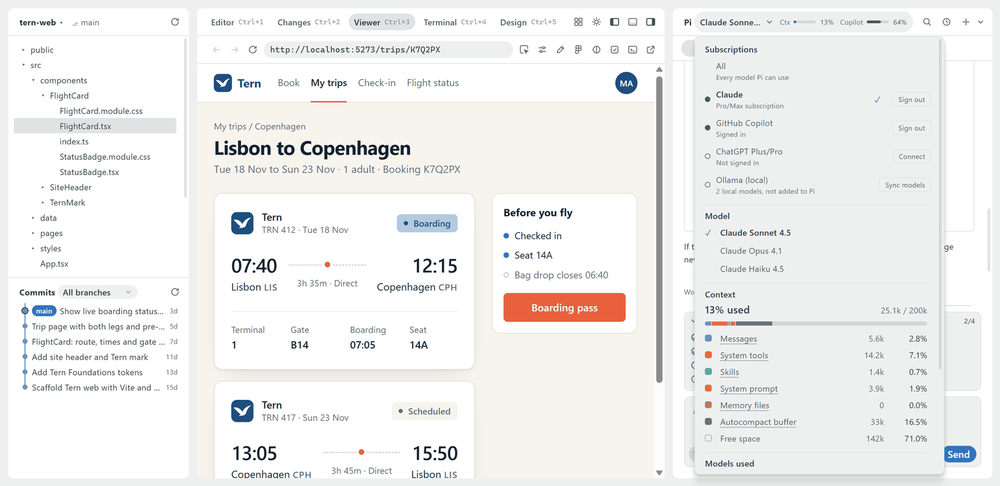</picture> | <picture><source media="(prefers-color-scheme: dark)" srcset="docs/screenshots/model-usage-context-dark.png">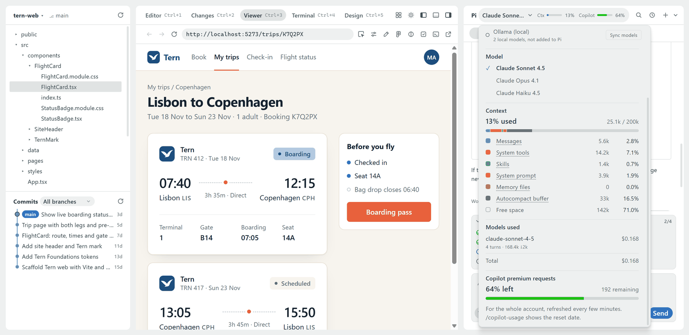</picture> |

**Extras**
- **Todos**: a collapsible panel above the input follows Pi's todo tool.
- **Mermaid**: ```` ```mermaid ```` blocks are drawn as diagrams in the app's colours (hover for a Code toggle).
- **Copy**: hover an answer to copy it as Markdown.
- **Find in chat**: ⌘F (Enter / Shift+Enter, Esc closes).
- **Notifications**: a system notification and Dock badge (taskbar badge on Windows) when Pi finishes or asks something while the window is in the background; a toast when it happens in another tab. Toggle with "Notifications" in the palette.

| Todos | Mermaid |
|---|---|
| <picture><source media="(prefers-color-scheme: dark)" srcset="docs/screenshots/todos-dark.png">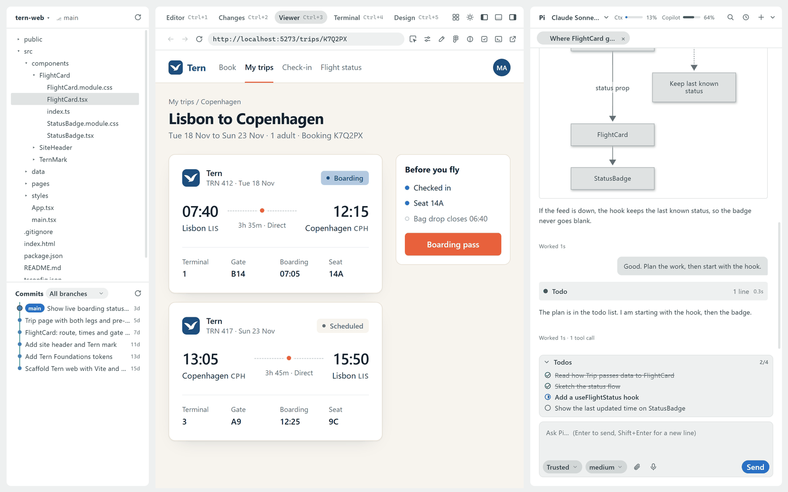</picture> | <picture><source media="(prefers-color-scheme: dark)" srcset="docs/screenshots/mermaid-dark.png">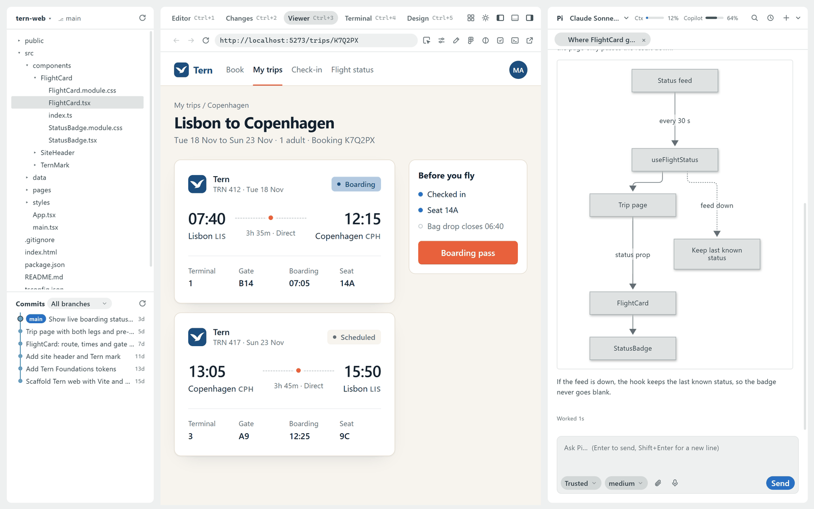</picture> |

## Claude Agent (optional)

Pi stays the default. Next to it Pi Crust has a second agent, **Claude Agent**, powered by Claude. You pick the agent for each chat when you start it, and a chat cannot switch agent later. Every chat shows its agent's name in a chip in the chat header. A Claude Agent chat also has a small diamond before its tab title; Pi tabs look as they always did.

**Start a chat.** **New chat** has a small arrow next to it. A plain click on **New chat** starts a Pi chat, as before. The arrow opens a menu with **Pi** and **Claude Agent**.

**What it needs.**
- **Your own Anthropic API key.** Usage is billed to your own Anthropic account. There is no sign-in with a Claude subscription: for that, use Pi.
- **A one-time engine download of about 175 MB.** The engine is the program that does the work. It is not in the installer. Pi Crust asks before it downloads a pinned version, and checks it before use.

A new Claude Agent chat opens with a setup card: step 1 is the key, step 2 is the engine. The message box stays off, and says why, until both are done. Nothing covers the app. Details and fixes are in [SETUP.md](SETUP.md#claude-agent-optional).

**Cost.** The cost shown for a chat is an estimate, not your bill. A chat pauses at about 5 dollars and asks before it goes on: a card at the end of the chat says what the chat has used, with **Continue** (up to another 5 dollars) and **Change limit**. The message box stays off until you choose. You can also change the limit in the Setup panel (the Claude Agent spend limit row, once you have started a Claude Agent chat) or in `settings.json` (see Configuration).

**How it differs from a Pi chat.**

| | Claude Agent chat |
|---|---|
| Works the same | Permission modes and the approval prompt, Stop, model choice, thinking level (shown as effort), slash commands (only a few of the engine's own, such as `/context` and `/usage`, are passed on; the others, like `/mcp` or `/plugin`, answer "not available"), images, subagent cards, tool cards, the context meter, checkpoints and Rewind, Earlier chats (they list both agents), and Fork (opens a new tab) |
| Different | The cost is an estimate. A message you send while it works runs after the current step, so there is no Alt+Enter steering and no queue strip. It compacts long chats by itself |
| Not available | `/clone`, `/export`, `/compact`, `/session`, `/name`, the advisor, and everything that comes from Pi's extensions: Pi's subscriptions and the Copilot quota. These controls are shown off with a reason, or are absent |
| Not on the phone | The [phone view](#remote-from-your-phone) shows Pi chats only |

**Rewind and fork.**
- **Rewind** is the same Rewind as in a Pi chat. Files come back from the app's own snapshots (see [History](#history-checkpoints-rewind-and-screenshots)).
- A rewound chat stays rewound if you close Pi Crust before sending your next message: it reopens as it was after the rewind.
- **Fork** (`/fork`) opens a new tab that continues from the end of the chat or from an earlier message. It is named "Fork of" and the title of the chat. A new fork that has no message yet reopens as the same empty fork tab after a restart.

**Safety.**
- The four **permission modes** and the same **approval prompt** apply to Claude Agent chats too (see Permission modes in the Chat section). The mode selector, the prompt and its answers work as in a Pi chat.
- Every mode runs the engine in its ordinary permission mode and Pi Crust decides each call, and Trusted runs everything, as for Pi: the protected list and the `/proc/.../environ` question apply in the other three modes only.
- They are a **safety net, not a sandbox**. A command you approve can do anything you can. On Windows the engine has no sandbox of its own, so the modes and the prompt are the only guard.
- A Claude Agent chat reads the project's `CLAUDE.md` as instructions (a file over 32 KB, a link, or one that leads out of the project folder is ignored). The project's own Claude settings and your own Claude settings are **not** loaded, so nothing in them can approve an action around the mode selector. Pi Crust gives the engine its own config folder, so a Claude sign-in you have on this computer is never used.
- The API key is kept in the operating system's protected store. It is kept out of the commands the agent runs. A key in the `ANTHROPIC_API_KEY` environment variable is used only when you have not saved one in the app.
- Other services' keys and tokens in your environment (variables whose names look like `..._API_KEY`, `..._TOKEN`, `..._SECRET`, `..._PASSWORD`, or a database connection string) are kept out of Claude Agent chats, so a command that needs one, such as a command-line tool that reads a token from the environment, will not find it there. Names that end in `_KEY`, `_SK` or `_PASSPHRASE`, or contain `COOKIE`, `AUTH`, `AUTHORIZATION` or `WEBHOOK_URL` as a whole part, are kept out too. Variables starting with `MAX_`, `ENABLE_`, `DISABLE_` or `MCP_` and a few others are also removed, so a command in a Claude Agent chat that relies on one of them will not see it. Pi chats work the same way for the commands they run, but Pi itself keeps its keys (see Permission modes). To let commands in either kind of chat keep a variable, list its name in `commandEnvKeep` in `settings.json`.

**What a Claude Agent chat sends to Anthropic.**
- Your prompts, and the files and command output the agent reads while it works, go to Anthropic through your own API key. Usage is billed to your Anthropic account. That is the whole purpose of the chat, and nothing else of yours is sent on purpose.
- Pi Crust sets the engine's own switches for usage telemetry, error reporting, the automatic updater (the app downloads one checked engine version itself), the feedback command and survey, feature-flag fetching, the automatic download of the official plugin directory, and its non-essential traffic in general. It sets them every time it starts the engine, and variables from your own environment that would reconfigure the engine (names starting with `ANTHROPIC_`, `CLAUDE_CODE_`, `MAX_`, `MCP_`, `OTEL_`, `ENABLE_`, `DISABLE_`, `BETA_TRACING_`, and `NODE_OPTIONS`, `BASH_ENV`, `API_TIMEOUT_MS`, `USE_BUILTIN_RIPGREP`) are not passed on to it.
- The engine's bundled skills and workflows are switched off with its switch for them, so the agent starts with your project's own instructions (`CLAUDE.md`) and its ordinary tools. Nothing is claimed here about other parts that ship with the engine.
- A real run with a key showed that, with all of those switches set, the engine still fetches a small policy file and a remote settings file from Anthropic into the app's own config folder. There is no documented switch for these two.
- Pi Crust has not measured everything the engine could send beyond the model requests and does not promise that those switches cover all of it. A company proxy set in your environment (`HTTPS_PROXY` and similar) is kept, so the engine uses it.

## Views

A view decides which features you see. Switch with the **All | Dev | Design** control in the tab bar, the palette (*View: Dev*), or ⌃⌘1 / ⌃⌘2 / ⌃⌘3. The choice is remembered.

- **All**: everything.
- **Dev**: Editor, Changes, Viewer, Terminal. No tweak, annotate and Figma tools, story bar or screenshots timeline.
- **Design**: Viewer, Design, Changes. No Editor, Terminal or devtools; the files and commits pane starts closed.

Each view remembers its own panel layout. ⌘1…⌘5 number the tabs of the current view. If something opens a hidden tab (say *Open in Editor* from a diff), it shows until you leave it.

## Middle tabs

Default order: **Editor, Changes, Viewer, Terminal, Design**. Drag a tab to move it (or ⌥⇧← / ⌥⇧→); ⌘1…⌘5 follow the order.

### Editor
Monaco, the editor of VS Code: syntax highlighting, multi-cursor, find/replace, command palette (F1), minimap.
- Click a file in the tree to open it. One tab per file; ● marks unsaved changes.
- ⌘S saves, ⌥⌘S saves all, middle-click or × closes a tab.
- ⌘L (or right-click → *Add Selection to Chat*) adds the selection as a pill in the chat.
- When Pi changes a file on disk, a clean tab reloads; a tab with unsaved changes asks.
- Open tabs and unsaved text are kept per repo, also across a restart.

### Changes
- Changed files with `NEW` / `MOD` / `STG` / `ADD` / `DEL` / `REN` badges, a filter for *files this chat changed*, and ↺ to discard a file.
- An **editable diff** (HEAD left, working tree right): inline or *Side by side*, *Copy*, *Open in Editor*, *Save* (⌘S), ⌘L adds selected lines to the chat. A file open in the Editor shares its unsaved text. Deleted, binary or very large files fall back to a text diff.
- **Git bar**: Commit, Commit + Push, Push, and **Create PR with Pi**, which asks Pi to open the PR following the repo's own conventions (it becomes **Open PR #N** once one exists). Committing or pushing on `main` asks first.

### Viewer
Your local dev build (default `http://localhost:3000`) and any project file you want to look at. The self-signed certificate is accepted for localhost only. Localhost links from the chat open here (in the tab that already shows that site, else a new one); other links open in your system browser. ⌘R reloads the page. The browser bar has the tools from [Working in the browser](#working-in-the-browser).

**Pages.** A row of tabs under the address bar holds up to 8 pages, in the order they were opened, a new one to the right of the active one. **+** (or ⌘T) opens a page on the dev address, **×** (or ⌘W) closes one, ⌥⌘← and ⌥⌘→ move between them. At 8 pages **+** is off and says "8 pages is the most. Close one first." A tab is named by its page title, else its file name, else its host. The pages are remembered per project, and the page you were on comes back after a restart; the others load when you open them. The picker, Tweak, Annotate, the element states, light/dark, reload, screenshots and the capture buttons work on the active page only.

**Project files.** The Viewer also shows web pages (HTML), images (SVG included) and PDFs from the open project. There are four ways to open one:
- Type the project path in the address bar (`docs/pricing.html`). Suggestions of matching project files appear while you type.
- Right-click a file in the tree and choose **Open in Viewer**.
- Click **Open in Viewer** in the Editor's status bar for the open file.
- Drag a file from the tree, Explorer or Finder onto the Viewer.

A file that is already open is shown in its own tab instead of a second one. The address bar shows the plain project path, not the internal address. An image or a PDF is shown as such; the tools that need a web page (picker, Tweak, element states, light/dark) are off for it with a reason, and Annotate and the capture buttons work on an image. Markdown files are not shown here.

**What a project page can and cannot reach.** A project page runs like any web page on the web: no Node, no preload script, no popups, no permissions. It can load relative and root-absolute files from its own project (the project is its own web address, so `/css/site.css` works), and it can load things from the internet, such as web fonts. It has its own browser session, separate for each project, so the logins and cookies of your dev browser are never sent to it. Every request is checked by one function: a path with `..`, an encoded dot or slash, a drive letter, a network path or a long one is refused; so is anything that starts with a dot (`.git`, `.env`, `.pi`), anything whose real path (through a link or junction) is outside the project, and a folder (no listing). Only files of the kinds the Viewer knows are served; the rest are not opened from the address bar. Text that is not a project file and not a web address is refused with a reason.

**Live reload.** The page you are looking at reloads about a quarter of a second after its file, or a file it loaded, changes. A page in a background tab reloads once when you open it. If the file is deleted the tab says "This file no longer exists" and loads again when the file is back.

**The agent can show you a page.** Both agents have one tool, `show_in_viewer`, with one argument: a path of a file in the open project (relative to the project folder, or absolute inside it), or an address on `localhost`, `127.0.0.1` or `[::1]` (http or https, any port). It opens the page in a new tab in the background, or, when a tab already shows it, marks that tab as updated with a small dot. Nothing takes your focus: the chat stays where it is and the page you were on stays active. The Viewer tab in the tab bar gets a small number badge until you look at it. The tool's card in the chat shows the file name; click the name to jump to that page. The tool decides nothing by itself. The app checks the argument with the same rules as the address bar and the drop: no other host, no path outside the project, no dot folder, no file kind the Viewer does not show, no `pi-project://` or `file:` address. A refusal comes back to the agent as the tool's result, in the same words. At 8 pages it is refused with "8 pages is the most. Close one first." At most three new pages are opened per turn, and asking again for a page that is open reuses its tab. Showing a project file needs exactly the permission that reading it needs in the chat's current mode: where a read runs without a question (Plan too) the tool runs, where a read would ask or is not allowed the tool is refused and never opens a question of its own. A localhost address is allowed in every mode. A chat in a worktree can only show localhost addresses, because the Viewer shows files of the open project, not of the worktree. For the Claude Agent the tool is the only tool the app adds (an in-process server named `pi-crust`), and it goes through the same hook and approval gate as every other tool.

### Mendix apps
When the repo holds a Mendix project (an `.mpr`, or an `.mpk` when there is no `.mpr`, up to 2 folders deep, skipping `node_modules`, `deployment` and similar), a **Mendix bar** shows under the Viewer's address bar. **Start** builds the project with a pinned [docker-mendix-buildpack](https://github.com/mendix/docker-mendix-buildpack) (`v6.0.8`), runs it next to a Postgres container for this repo, waits until it answers and opens it in the Viewer tab. The same actions are in the palette as *Mendix: …*.

- **Needs:** Docker Desktop running, `git` and Python 3.8 or later on the host (**Windows isn't supported yet**: the buildpack needs Python and Docker inside WSL, so Start stops with a message there). The app must be Mendix 8 or later; older projects get a clear error.
- **First build** takes minutes (base images, mxbuild download). The bar shows the step and a clock; **Stop** cancels. Cancelling sends SIGINT to the build, then SIGKILL after 5 s, and removes leftover `mendix-buildpack:mxbuild-*` containers. `build.py` calls `docker`, so the docker found by Pi Crust is put first on its `PATH`; if you use podman, make a `docker` alias for it or Docker Desktop's CLI will be used. The buildpack is cloned once to the app data folder (`mendix/buildpack/<tag>`).
- **Apple Silicon:** the buildpack says ARM64 isn't fully supported. Mendix 9.22 and later build natively; older versions build under amd64 emulation (slow; turn on Rosetta for x86_64/amd64 emulation in Docker Desktop).
- **Buttons:** Start, Stop, Rebuild (compile again), Open, **Logs** (drawer with build and app output), **Admin** (copies the `MxAdmin` password), and under **⋯** *Reset database…* and *Follow logs in Terminal*.
- **Admin password:** made once per repo (and a separate database password), kept in `settings.json`, never put on a command line or in the log. Log in as `MxAdmin`.
- **Docker objects**, named `pcm-<repo>-<hash>-…`: containers `-app` and `-db`, network `-net`, volume `-pgdata`, image `-app:latest`. Postgres keeps its data in the volume and keeps running after you quit; the app container is stopped on quit (setting `mendixStopOnQuit`).
- **Remove everything by hand:** `docker rm -f <key>-app <key>-db; docker volume rm <key>-pgdata; docker network rm <key>-net; docker rmi <key>-app:latest` (find them with `docker ps -a --filter label=dev.picrust.mendix`).

### Terminal
A login shell in the repo (PowerShell on Windows), using the repo's Node (`.nvmrc`). While a command runs (dev server, Storybook, …) the bar shows it with a green dot and its running time, and the tab gets a timer badge.

## Design tab

⌘5. The view button at the top right of the tab bar (⌃⌘1/2/3) switches between the All, Dev and Design views.

**Compare.** *Get Figma selection* loads the frame selected in Figma desktop; *Capture build* captures the Viewer tab at the frame's size, the current viewport or a picked element. View them as **Slider**, **Onion skin**, **Side by side** or **Diff** (pixel heatmap, "92.4 % match", threshold slider). *Send to chat* adds the images with a note.

<picture><source media="(prefers-color-scheme: dark)" srcset="docs/screenshots/diff-dark.png">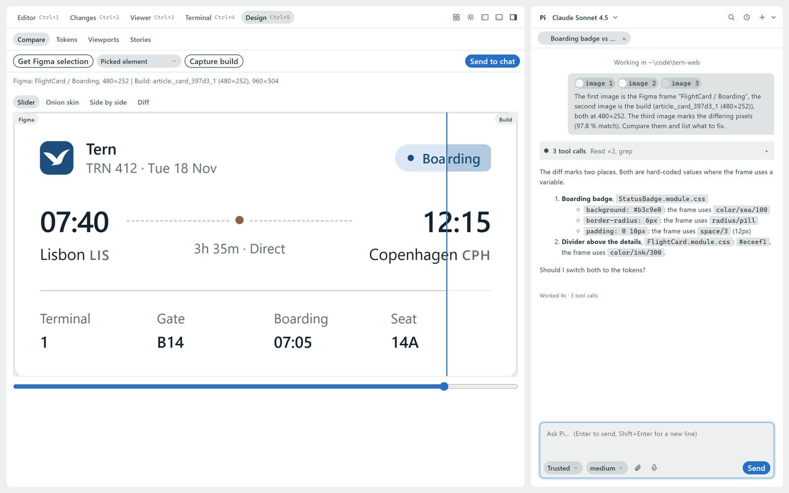</picture>

**Tokens.** The page's tokens as colour swatches (with contrast), spacing bars, radii and type specimens. **Compare with Figma variables** shows ✓ same, ≠ different, only in code, only in Figma. The search field finds a token by name or value (`#1a73e8`, `rgb(26,115,232)`, `12px`, `0.75rem`): exact matches first, then the nearest few with their delta. Click a token to copy its name, ⌥-click for `var(--name)` or the theme path; ⌘K › Find token… jumps to the field. Pages without tokens can use a JSON file via `designTokensFile` (see [Configuration](#configuration)).

<picture><source media="(prefers-color-scheme: dark)" srcset="docs/screenshots/tokens-dark.png">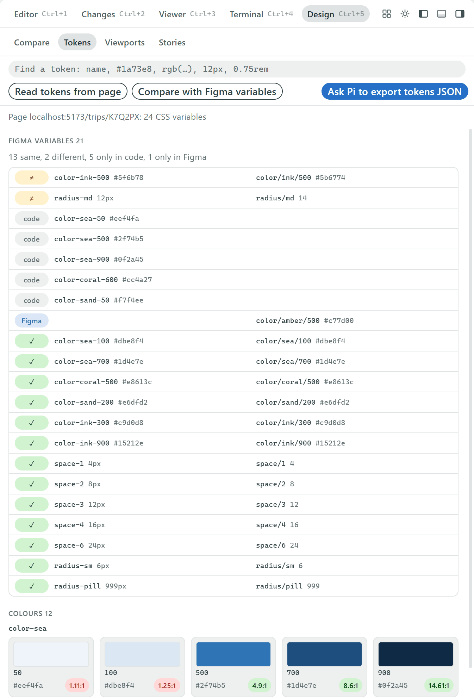</picture>

**Viewports.** Your app at **Mobile** 390×844, **Tablet** 820×1180 and **Desktop** 1440×900, in **Light**, **Dark** or **Both**. Snapshots refresh shortly after files change. Click a tile to enlarge it or send it to the chat.

<picture><source media="(prefers-color-scheme: dark)" srcset="docs/screenshots/viewports-dark.png">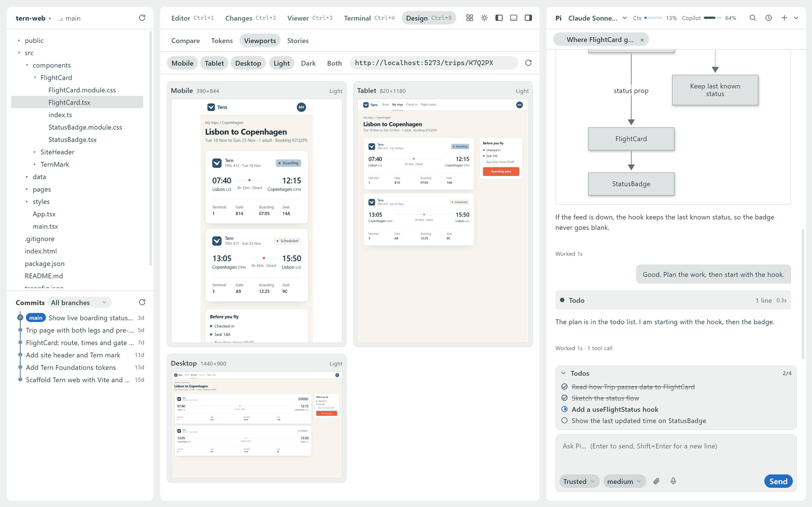</picture>

**Stories.** The project's Storybook as a gallery grouped by title, with a filter.
- Storybook is found automatically (`localhost:6006`, the ports of the repo's `storybook` scripts, or `storybookUrl`). If it isn't running, **Start Storybook** runs it in the Terminal tab.
- **Click a story to work on it**: the Viewer tab opens just that story, so the picker, Tweak and Annotate see only that component. A story bar offers sibling stories, **Component**, **Stories file**, **Figma**, **Storybook UI** and **Work on with Pi** (adds a thumbnail and a `<storybook-story>` block to the input).
- **All / In Figma**: *In Figma* shows only stories whose component is in the Figma file where the figma-console **Desktop Bridge** plugin runs, with a badge per tile, plus a list of Figma components without a story.

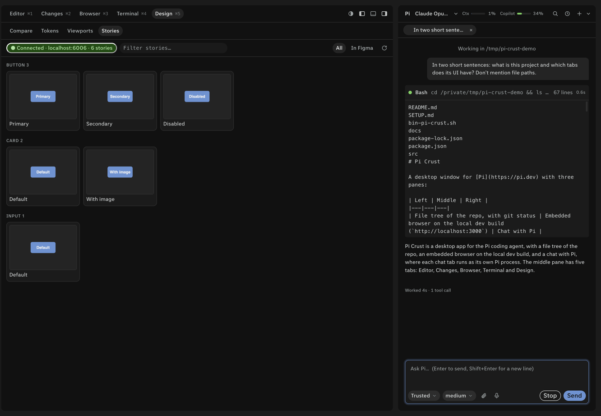

## Working in the browser

The buttons in the browser bar (also in the palette):

| Tool | How | What you get |
|---|---|---|
| **Element picker** | 🎯 or ⌘⇧C. Hover, click to pick, Shift+click for more, Esc to finish. | A `<browser-element>` block in the input: selector, React component chain, source files, text, key styles, HTML and a screenshot. Nothing is sent. |
| **Token check** | Automatic while picking | Chips in the hover label: ✓ theme token, ✗ hard-coded. The block gets the nearest token for each hard-coded value. |
| **Figma picker** | Figma button or ⌘⇧F | The layer selected in Figma desktop as a `Figma: <name>` pill, with the file link, node id and which properties are bound to variables. |
| **Tweak** | Sliders button | A live panel for padding, gap, radius, font size, colour and background, snapping to the page's tokens (hold ⌥ for free values). **Apply with Pi** asks Pi to make the change in code. |
| **Light/dark** | Half-circle button, or palette *Viewer: toggle light/dark* | Cycles Auto (follows the app) → Light → Dark for the dev browser only (`prefers-color-scheme`). Remembered across restarts. |
| **Element states** | Checkmark button | A row to force `:hover`, `:focus`, `:focus-visible`, `:active` or disabled on the last picked/tweaked element (or its button/link/input ancestor). Besides the CSS state it really hovers and focuses the element, so JS states like MUI's `.Mui-focused` / `.Mui-focusVisible` follow; disabled also adds `.Mui-disabled` on MUI components. Moving the mouse into the page undoes hover. Cleared on navigation or with **Clear**. |
| **Annotate** | Pen button | A drawing overlay (pen P, arrow A, box B, text T, undo ⌘Z) on a screenshot; **Add to chat** attaches the marked-up image. |

The Figma picker and Design compare talk to the Figma desktop MCP server (`http://127.0.0.1:3845/mcp`), so Figma desktop must be open with that server on. The **Figma status** pill at the right of the Design tab bar shows whether that works (*Figma: ready*, *not connected*, *open a file*, *switch tab*, *select a frame*, *problem*). Click it for a short checklist and a **Test connection** button; it checks when you open the Design tab or the panel, and after a Figma action fails, never on a timer. The desktop server needs a Dev or Full seat. Only the Figma picker needs the file link (the server doesn't expose the file key): save a `figma.com/design/<key>/<name>` link in the panel, once per project, or paste it into the chat input. Compare and Tokens don't need it.

| Tweak | Annotate |
|---|---|
| <picture><source media="(prefers-color-scheme: dark)" srcset="docs/screenshots/tweak-dark.png">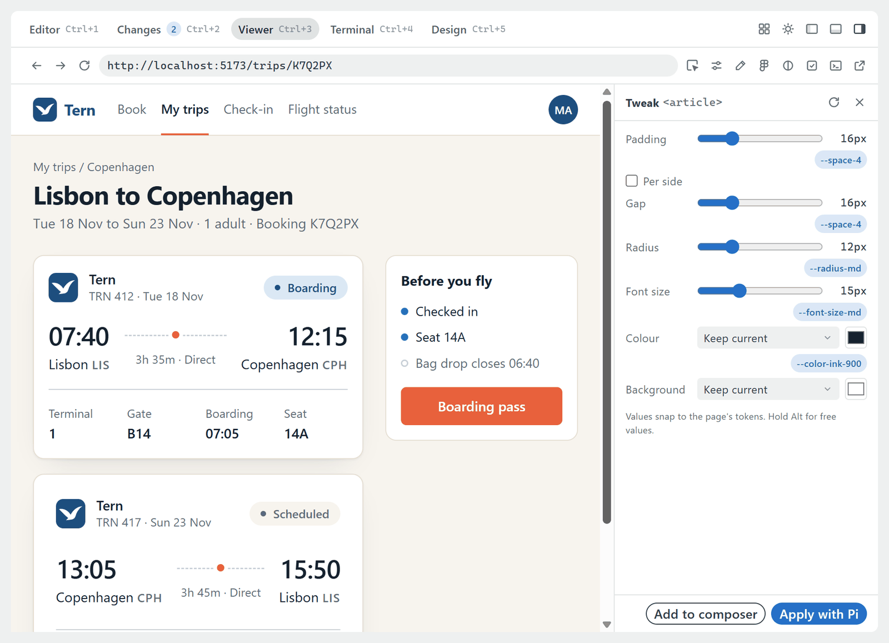</picture> | <picture><source media="(prefers-color-scheme: dark)" srcset="docs/screenshots/annotate-dark.png">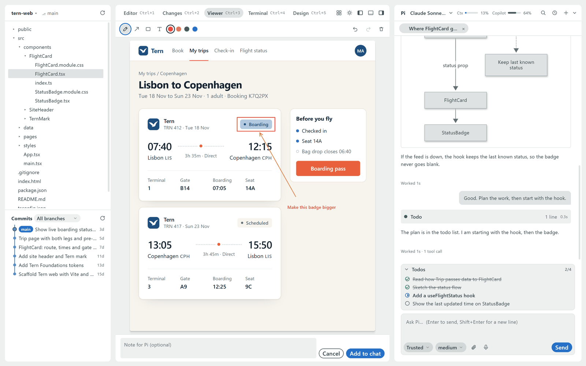</picture> |

## History: checkpoints, rewind and screenshots

**Checkpoints.** Each message you send snapshots the working files (tracked and untracked, not git-ignored) just before it goes to Pi.
- Hover one of your messages: the **pencil** forks the conversation to before it and puts the text back in the input; the **rewind arrow** lists the file changes and restores code and/or conversation, with *Undo restore*.
- `/rewind` and the palette do the same.
- Snapshots are commits under `refs/pi-crust/cp/*`, built with a temporary index, so your index, HEAD, branches and stash are never touched. The last 300 are kept. Untracked files end up in `.git` objects until pruned; a restore never overwrites ignored files.

**Before/after screenshots.** When a turn that edited files ends, the Viewer tab is captured before and after. The chat gets a *Before / after* card (slider, overlay, side by side), and a **Screenshots** strip under the chat tabs lists every turn, with *Show in chat* and *Rewind to before this turn*. Toggle in the palette.

| Rewind | Screenshot timeline |
|---|---|
| <picture><source media="(prefers-color-scheme: dark)" srcset="docs/screenshots/rewind-dialog-dark.png">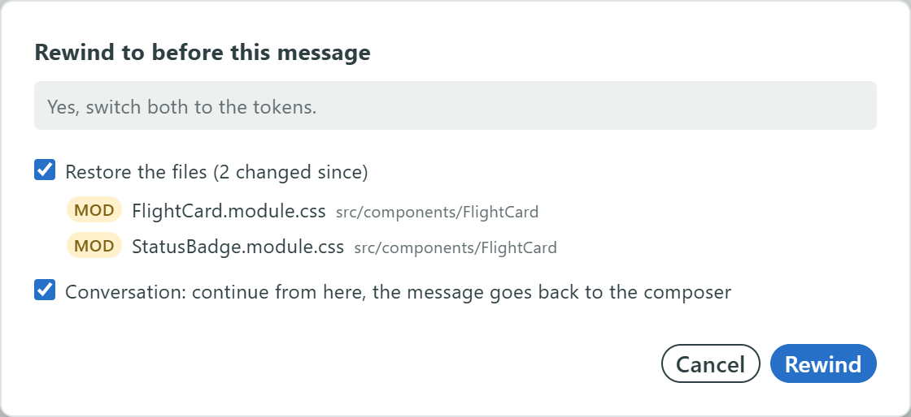</picture> | <picture><source media="(prefers-color-scheme: dark)" srcset="docs/screenshots/before-after-dark.png">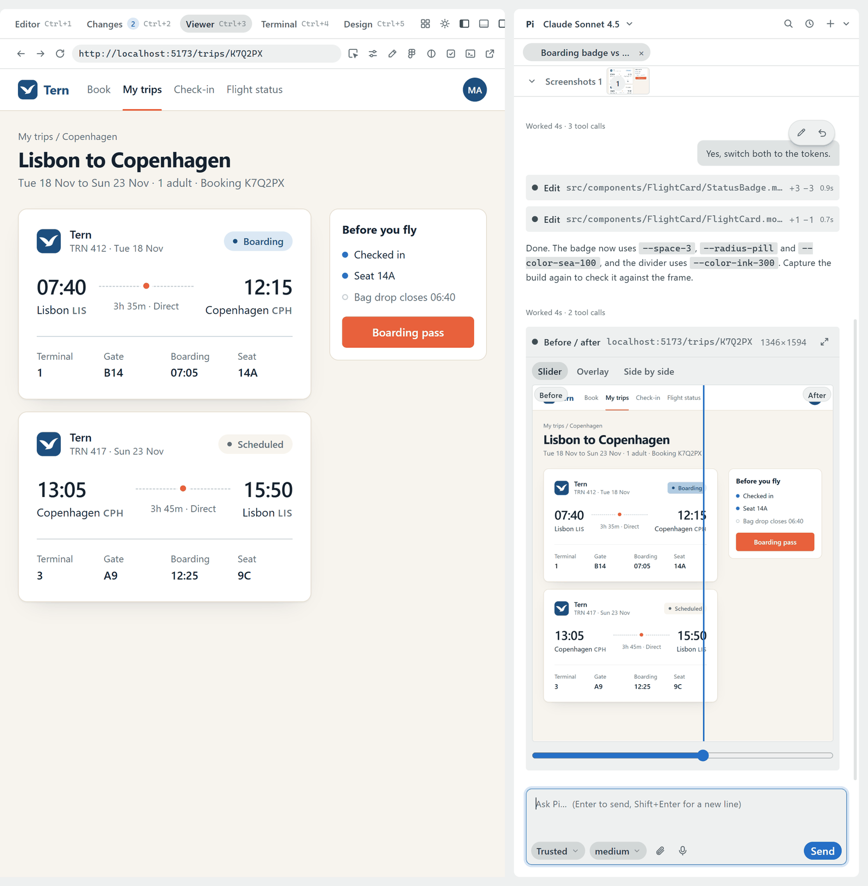</picture> |

## Worktree per chat

The chevron next to **＋** (or *New chat in worktree…*) asks for a branch name (default `pi/<yyyymmdd-hhmm>`) and runs `git worktree add -b <branch>` in the app's data folder, never inside your checkout. Pi in that chat works there.
- The tab gets a branch badge. While it is open, Changes, the git bar and checkpoints work on the worktree, and a banner says so. The file tree, editor and commit graph keep showing your main checkout.
- Worktree chats show up in Earlier chats and reopen in their worktree after a restart.
- Closing the tab asks whether to remove the worktree (the branch is always kept).
- A new worktree has no `node_modules`; the toast offers *Install dependencies*.

## Keyboard shortcuts

On Windows, ⌘ and ⌃ mean Ctrl and ⌥ means Alt. Ctrl+W does not close the window there.

| Keys | Action |
|---|---|
| ⌘K | Command palette: files, skills, prompt templates, extension and slash commands, app actions |
| ⌘N | New chat |
| ⌘J | Earlier chats |
| ⌘⇧[ / ⌘⇧], Ctrl+Tab | Previous / next chat tab |
| ⌘1 … ⌘5 | Middle tabs (of the current view) |
| ⌃⌘1 / ⌃⌘2 / ⌃⌘3 | View: All / Dev / Design |
| ⌘F | Find in chat |
| ⌘⇧C | Element picker |
| ⌘⇧F | Figma picker |
| ⌘⇧Space | Voice input |
| ⌘L | Add editor / diff selection to the chat |
| ⌘S / ⌥⌘S | Save / save all |
| ⌘R | Reload the Viewer tab |
| ⌘T / ⌘W | New page / close the page, in the Viewer tab only (the row of pages under the address bar; 8 pages at most) |
| ⌥⌘← / ⌥⌘→ | Previous / next page in the Viewer tab |

**File tree**: click (or Enter) opens a file in the Editor, double-click mentions it in the chat, ⌘-click opens it in VS Code. Drag the pane borders to resize; the layout is remembered.

**Slash commands** typed in the chat: `/reload`, `/new`, `/compact`, `/model`, `/fork`, `/thinking`, `/rewind`, … (terminal-only ones point you to the Terminal tab).

<picture><source media="(prefers-color-scheme: dark)" srcset="docs/screenshots/palette-dark.png">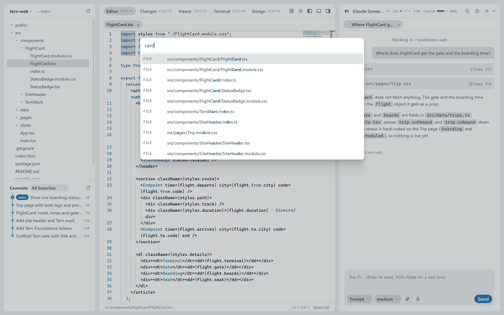</picture>

## Remote from your phone

Chat with Pi from your phone, in a small web app that Pi Crust serves itself. The phone shows Pi chats only: Claude Agent chats are not listed there. You choose which chats the phone can use. In the phone you can see those chats, read them live, send prompts, stop a run, answer Pi's questions, start a new chat and restart one that stopped. You can't use the terminal, the files or git from the phone.

Turn it on with *Remote access…* in the command palette, `/remote`, or the 📱 button in the chat header. The panel walks you through the setup.

- **Sharing is per chat.** Open a chat and turn on *Use this chat from your phone* in the 📱 menu (or in the palette). Only shared chats appear on the phone; the rest stay invisible and can't be reached. Shared chats get a small phone icon on their tab, and *Remote access…* lists them with a *Stop sharing* button. Sharing a chat turns Remote on. A chat you start from the phone is shared automatically. Sharing is remembered per session, so it survives a restart of Pi Crust, and closing a chat ends it.

- **Tailscale (recommended).** Install Tailscale on the computer and the phone and sign in to the same tailnet. In the Tailscale admin console, on the DNS page, turn on MagicDNS and HTTPS certificates. Then press *Set up Tailscale Serve* in the panel. You get an `https://` address that only your tailnet can reach. Pi Crust refuses to use a port that has Tailscale Funnel on or already serves something else, and it stops Remote if Funnel is turned on later. See [SETUP.md](SETUP.md#remote-access-with-tailscale-optional).
- **Wi-Fi (LAN).** Plain `http://` on your private network. Traffic isn't encrypted and there are no notifications, so use it only on a network you trust. If you have several networks (VPN, virtual machines), pick the right one in the panel. A phone paired over Wi-Fi only works in Wi-Fi mode, and that pairing lasts 30 days.
- **Pairing.** Press *Pair a phone*, then scan the QR code or type the code. A code works once and expires after 5 minutes. In Tailscale mode, pair only after Serve is set up. On iPhone, add the page to your Home Screen first and pair inside the app, because the installed app keeps its own login.
- **Notifications.** With Tailscale (https) the phone can notify you when Pi finishes or asks something. Turn them on in the phone app. The panel has a *Show message text in notifications* option; switch it off and notifications only say that Pi finished or needs you. On iPhone this needs iOS 16.4 or later and the page added to the Home Screen.
- **Security.** Each phone gets its own login token, stored hashed on the computer and kept in the phone app's local storage (not in a cookie, so it is never sent to other sites or ports on the same address). *Unpair* in the panel cuts a phone off at once. The server listens on `127.0.0.1` (Tailscale) or one private Wi-Fi address (LAN), never on the public internet. Every request is checked for the right host, origin and login.
- **Staying awake.** Pi Crust keeps the computer from sleeping while a phone is connected or a chat is working, but closing a laptop lid still puts it to sleep.
- **Windows.** Closing the window quits the app, and that turns Remote off.
- **Where it's stored.** `remote.json` in the app's data folder (paired phones, shared sessions, port, mode, push keys). Delete a phone in the panel instead of editing it.

## Configuration

**Environment variables**

| Variable | Default |
|---|---|
| `PI_CRUST_CWD` | unset: the repo picker is shown |
| `PI_CRUST_URL` | `http://localhost:3000/` |
| `PI_CRUST_FIGMA_FILE_KEY` | unset; `figmaFiles` (per project) or `figmaFileKey` in `settings.json` wins |
| `PI_CRUST_PI` | found automatically: nvm's default Node, then other nvm versions, then Homebrew / `~/.local/bin` |

**`settings.json`** (in the app's data folder, `~/Library/Application Support/pi-crust/`; on Windows `%APPDATA%\pi-crust`)

| Key | Purpose |
|---|---|
| `figmaFiles` | The Figma file for the Figma picker, per project (saved in Design › Figma status or by pasting a link); `figmaFileKey` and `figmaFileName` are the older app-wide value, used when a project has none |
| `storybookUrl` | Storybook address; empty means auto-detect |
| `designTokensFile` | JSON with `colors`, `spacing`, `radii`, `typography`, relative to the repo |
| `claudeMaxBudgetUsd` | Claude Agent: the amount in US dollars at which a chat pauses and asks before going on (default 5, at least 0.5). **Change limit** on the pause card and the Setup panel's spend limit row write it |
| `claudeMaxTurns` | Claude Agent: the number of steps a run may take before it pauses (default 100) |
| `commandEnvKeep` | Names of environment variables that commands in a chat may keep, for both agents (default none), for example `["GH_TOKEN"]`. A text with names separated by commas works too. On Windows the case of a name does not matter. Applies to chats started afterwards |
| `toolCallCheckIn` | Ask "Keep going?" after this many tool calls in one run (default 40, `0` = off). Applies to chats started afterwards |
| `mendix` | Per-repo Mendix passwords and port; written by the app |
| `mendixStopOnQuit` | Stop the Mendix app container when Pi Crust quits (default `true`; Postgres keeps running) |
| `mendixPostgresImage` | Postgres image for the Mendix database (default `postgres:14-alpine`) |
| `mendixStartTimeoutSec` | How long to wait for the Mendix app to answer (default 300) |
| `figmaConsoleMcp` | figma-console MCP server config, if not taken from `~/.pi/agent/mcp.json` |

Pi runs on the Node it was installed with, whatever the repo's `.nvmrc` says; the terminal uses the repo's Node.

## Development

```bash
npm test
```

Runs every `src/*.test.js` and `scripts/*.test.js`; these are gitignored and stay local (pure logic: durations, checkpoints, pixel diff, tokens, Storybook, worktrees, voice, the secret check, …).

**Secret check.** `npm install` turns on the git hooks in `.githooks` (`core.hooksPath`). Every commit and every push is checked by `scripts/check-secrets.js`: no `.env`, `auth.json`, SSH keys, certificates or `.npmrc`, and no API keys or tokens (Anthropic, OpenAI, GitHub, AWS, Google, Slack, Figma, npm, Tailscale), private keys, JWTs, passwords in URLs or hard-coded `password = "…"` values in added lines. In test files (`*.test.js`, `*.spec.*`, `test/`, `tests/`, `__tests__/`) the generic URL-password and `password = "…"` checks are skipped, since those hold made-up values; real token formats are still caught there. When something is found, nothing is committed or pushed and the report shows the file, line and a masked sample. The push check also catches commits made with `--no-verify`. A false positive gets the comment `secret-check: allow` on that line. `npm run check-secrets` checks every tracked file; `node scripts/check-secrets.js --history` checks every commit. A local, untracked `.leak-denylist` in the repo root (or `--denylist FILE`) lists words that must never appear in the repo (one regex per line, case-insensitive); hits are reported by file, line and rule number only, and `--require-denylist` makes a missing list fail (for CI). Binary files are skipped and counted. In CI the list comes from the repository secret `LEAK_DENYLIST` (one rule per line): `scripts/ci-denylist.js write` puts it in a file in the runner temp folder (it fails when the secret is empty, for example on pull requests from forks) and `delete` removes it again. Other modes: `--file F` and `--stdin` scan release notes, `--dir DIR` scans build output (file names and contents; `--skip PATH` or `--skip *.ext` leaves third-party content out, names are still checked). A scan that covered 0 files, or 0 commits, fails. Paths that match the list are never printed.

```bash
npm run selftest
```

Opens the app, sends one prompt, answers Pi's dialogs with their first option, visits every tab and feature, saves a screenshot of each to `out/` and quits. It opens this repo unless `PI_CRUST_CWD` or a path argument says otherwise; `PI_CRUST_SELFTEST_PROMPT` sets the prompt. UI console errors and `MISMATCH` lines point at problems. The screenshots in `docs/screenshots/` come from a selftest run on a clean clone.

To test one feature, name it: `npm run selftest -- timeline` (or several: `npm run selftest -- timeline annotate`; same as `PI_CRUST_SELFTEST_ONLY=timeline,annotate`). It still sends the prompt, then runs only the steps registered by those feature scripts (named after the file, e.g. `chat-find`, `design-tokens`, `worktree`; `durations` for the turn timers; `core` for the built-in tour of tabs, editor, palette, layout and zoom). An unknown name prints a `MISMATCH` line listing the known ones.

After changing `node-pty` or Electron, rebuild the native module: `npx electron-rebuild -f -w node-pty` (not on Windows, where `node-pty` uses prebuilt binaries).

To build the Windows installer, run `npm run dist:win`. It writes `dist\Pi-Crust-Setup-<version>.exe` (see [SETUP.md](SETUP.md#install-as-an-app)). The macOS build is manual and not part of releases: releases (and their CI builds) are Windows only. On a Mac, `npm run dist:mac` writes `dist/Pi Crust-<version>-<arch>.dmg` (see [SETUP.md](SETUP.md#install-as-an-app-macos)).

### Files

Main process (`*-main.js` modules export `register(ctx)` and get one line in `main.js`):

| File | Role |
|---|---|
| `main.js` | Window, one Pi subprocess per chat (strict JSONL), file tree, git, embedded browser |
| `preload.js` | The narrow bridge to the UI, one namespace per feature |
| `checkpoints-main.js` | Checkpoints and restore |
| `snap-main.js` | Screenshots of the dev browser and offscreen pages, shot storage |
| `watch-tree.js` | Recursive folder watching; on Linux a pruned, asynchronous walk instead of Node's full one |
| `design-main.js`, `figma-mcp.js` | Figma desktop MCP: selection, screenshots, variables, connection probe |
| `viewer-agent-main.js`, `viewer-agent-logic.js`, `viewer-agent-target.js`, `viewer-agent.js` | The agent's tool `show_in_viewer`: what it may show (logic and argument rules), the main side, the badge and the tool card link; Pi's side is `pi-viewer-tool.js` (registered by `pi-extension/crust-guard.ts`), the Claude Agent's is `agents/claude/viewer-tool.js` (selftest: `node scripts/viewer-agent-selftest.js`) |
| `figma-status.js`, `figma-main.js`, `figma-panel.js` | Figma connection status: states and words, IPC with the per-project file link, the Design tab pill and checklist (selftest: `figma-panel`, with `scripts/figma-stub-server.js`) |
| `figma-bridge-main.js`, `figma-match.js` | figma-console Desktop Bridge server, matching components to stories |
| `storybook-main.js` | Finding, starting and reading Storybook |
| `mendix-main.js`, `mendix-logic.js` | Running a Mendix app: Docker build and run, state machine; the pure parts (detection, names, docker arguments, errors) |
| `worktree-main.js` | Git worktrees per chat |
| `voice-main.js`, `voice.js` | Local transcription with whisper-cli |
| `update-main.js` | Updating Pi Crust itself from its git clone (runs `scripts/update.js`; the installed Windows app via `scripts/dist-win.js` and its installer) |
| `remote-main.js`, `remote-server.js` | Remote access: lifecycle, Tailscale, push; the HTTP server for the phone |
| `remote-auth.js`, `remote-routes.js`, `remote-share.js`, `remote-state.js`, `remote-tailscale.js`, `webpush.js` | Remote's pure parts: pairing and tokens, routes and header checks, chat state, Tailscale parsing, Web Push |
| `remote/` | The phone web app (served by the server above) |
| `picker.js` | Element picker and token check injected into the page |

UI (all in `src/`):

| File | Role |
|---|---|
| `renderer.js` | Chat, file tree, browser bar, dialogs, hook bus (`onCrust` / `emitCrust`) |
| `changes.js`, `changes-editor.js` | Tabs, Changes view with the Monaco diff, git bar |
| `editor.js`, `terminal.js` | Editor (Monaco) and Terminal (xterm.js + node-pty) tabs |
| `context-panel.js`, `pi-extension/crust-context.ts` | Model & usage pill and popover |
| `pi-extension/advisor.ts`, `advisor-main.js` | Anthropic advisor tool in each chat's Pi; the pointer for subagents and terminal Pi |
| `sessions.js`, `slash.js`, `palette.js` | Earlier chats, slash commands, command palette and shortcuts |
| `subagents.js`, `duration.js` | Live subagent view, durations and progress |
| `notify.js`, `chat-find.js`, `thinking.js`, `mention-menu.js`, `todo-panel.js`, `mermaid-render.js`, `voice-ui.js` | Chat extras |
| `rewind.js`, `turn-shots.js`, `timeline.js`, `compare-view.js` | Rewind, before/after shots, timeline, compare widget |
| `design*.js`, `pixel-diff.js`, `page-tokens.js`, `token-match.js`, `annotate.js`, `tweak.js` | Design tab, annotate overlay, tweak panel |
| `worktree.js` | Worktree chats in the UI |
| `mendix.js` | Mendix bar, log drawer and palette commands in the Viewer tab |
| `remote-panel.js` | Remote access panel and header indicator |
| `app-update.js` | The Pi Crust update card in the notifications above the chat |
| `index.html`, `styles.css` | Layout and styles |

Design notes: [docs/visual-features-plan.md](docs/visual-features-plan.md), [docs/figma-pane-plan.md](docs/figma-pane-plan.md).
