# Pi Crust

A desktop app for [Pi](https://pi.dev): your repo, your running app and a chat with Pi in one window.

Pi Crust runs on macOS and Windows 11. Read how and why it was designed in the case study at [nullvorm.com/pi-crust](https://nullvorm.com/pi-crust).

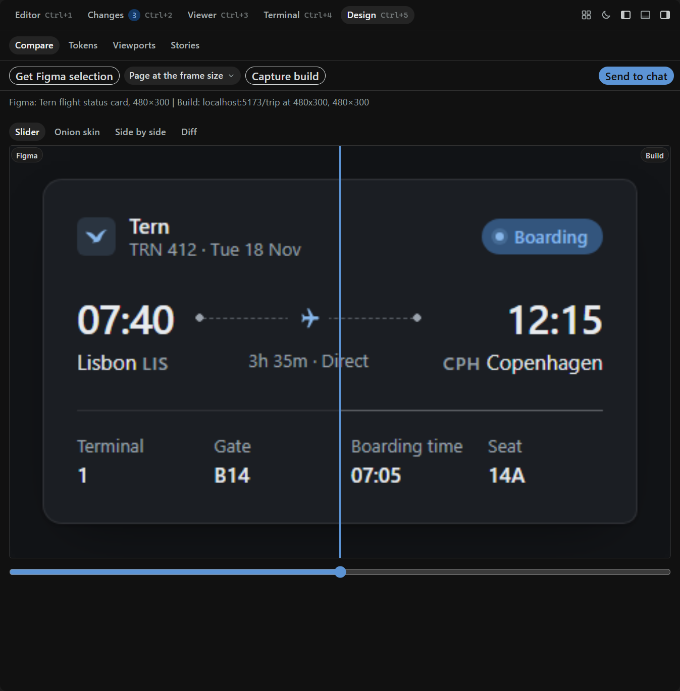

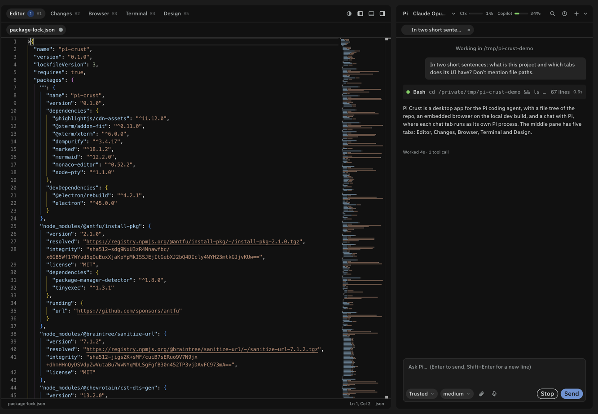

| Left | Middle | Right |
|---|---|---|
| File tree with git status and the commit graph | Editor, Changes, Viewer, Terminal and Design tabs | Chat with Pi, one tab per chat |

Pi runs as a subprocess in RPC mode (`pi --mode rpc`), so everything in `~/.pi/agent` keeps working: the model, subagents, extensions, skills, MCP servers and the Copilot usage status.

The layout and some ideas (startup probe, process-group shutdown, tool cards, prompt recall) were inspired by [Pi Desktop](https://github.com/FaqFirebase/pi-desktop). No code was copied.

## Contents

- [Quick start](#quick-start)
- [Chat](#chat)
- [Views](#views)
- [Middle tabs](#middle-tabs)
- [Design tab](#design-tab)
- [Working in the browser](#working-in-the-browser)
- [History: checkpoints, rewind and screenshots](#history-checkpoints-rewind-and-screenshots)
- [Worktree per chat](#worktree-per-chat)
- [Keyboard shortcuts](#keyboard-shortcuts)
- [Remote from your phone](#remote-from-your-phone)
- [Configuration](#configuration)
- [Development](#development)

## Quick start

See [SETUP.md](SETUP.md) to install, for macOS and Windows. To get the latest version later, press **Update** when *Pi Crust update available* shows in the notifications above the chat, or run `npm run update` in this folder (see [SETUP.md](SETUP.md#update)). To start:

**macOS**

```bash
pi-crust                 # shows the repo picker (or reopens the last repo)
pi-crust ~/some/repo     # opens that repository
```

You can also open **Pi Crust** from Applications (Spotlight or the Dock) after installing it as an app with `npm run update -- --app` ([SETUP.md](SETUP.md#install-as-an-app-macos)), or run `npm start` in this folder. Logs go to `~/Library/Logs/pi-crust.log`.

**Windows**

```powershell
npm run dist:win         # builds dist\Pi Crust Setup <version>.exe
```

Run the installer. It installs for your user only (no admin) and adds Start Menu and desktop shortcuts and an uninstall entry. The installer is not signed, so SmartScreen asks: choose More info, then Run anyway.

Then open **Pi Crust** from the Start Menu, or use the launcher in a terminal (cmd or PowerShell):

```powershell
pi-crust                 # shows the repo picker (or reopens the last repo)
pi-crust C:\path\to\repo   # opens that repository
```

The `pi-crust.cmd` launcher prefers the installed app. `npm start` also works from this folder. Logs go to `%LOCALAPPDATA%\pi-crust\logs`, one log per launch. For prerequisites and the steps to run from source, see the Windows section of [SETUP.md](SETUP.md#windows).

**Docker (Linux container, used in your browser)**

```bash
PROJECTS=~/Documents WORKSPACE=~/Documents/some-repo docker compose -f docker/compose.yml up --build -d
```

Then open http://localhost:6080/. Logins, full screen, clipboard and reaching services on your computer: see [docker/README.md](docker/README.md).

## Chat

**Basics**
- Enter sends, Shift+Enter adds a new line, Up/Down recalls earlier prompts, Esc or **Stop** aborts.
- A message sent while Pi works is queued as steering.
- Pi's questions (permission prompts, the `question` tool, confirmations) appear in a panel above the input, not as a popup. Esc cancels.

**Chat tabs.** Every chat is its own Pi process, so several chats run in parallel and keep working in the background.
- **＋**, ⌘N, `/new` or *New chat* in the palette opens a new tab; the current chat is never wiped.
- A tab shows ✻ while it works (with its elapsed time), ● when it finished in the background and **?** when it waits for an answer.
- Each tab keeps its own draft, model, thinking level and permission mode.
- **Earlier chats** (⌘J) reopens a saved chat in a new tab.

**Tool cards and progress**
- Tool calls show as cards with a live timer; edits show a diff.
- **Subagent** cards show each agent live: model, status, elapsed time, tool calls, result, and "step X of N" (chain) or "N of M done" (parallel).
- While Pi works the status line shows the turn time, tool count and last tool. When it is done: "Worked 3m 05s · 12 tool calls".

**Composer controls**

| Control | What it does |
|---|---|
| Permission mode | Plan (read-only), Ask before edits, Ask before commands, Trusted. Shared with Pi in the terminal (`/mode`, see `~/.pi/agent/extensions/permission-modes.ts`). |
| Thinking level | The select next to it (also `/thinking`). |
| `@` mentions | Type `@` for files and folders; Tab / Enter inserts `` `path` ``. |
| Voice input | Mic button or ⌘⇧Space records; press again to stop, Esc cancels. Transcribed **locally** with [whisper.cpp](https://github.com/ggerganov/whisper.cpp) and put in the input, never sent by itself. See [SETUP.md](SETUP.md#optional). On Windows it uses `whisper-cli.exe`. |

**Model & usage.** The pill at the top of the chat shows the model, how full the context is (**Ctx**) and the Copilot premium requests left. Click it (or `/model`) to switch models and see:
- the context split into messages, system tools, skills, system prompt, memory files (AGENTS.md / CLAUDE.md), autocompact buffer, free space and deferred tools;
- the **models used** in this session (turns, tokens and cost per model, subagents included);
- the Copilot quota for the whole account.

**Subscriptions.** The top of the same popover (or *Subscriptions…* in the palette) lists the accounts Pi can use: Claude, GitHub Copilot, ChatGPT Plus/Pro and Ollama (local), each with a status dot and one button.
- **Connect** signs in inside the app: it runs Pi's own login code (the same as `/login`, so `~/.pi/agent/auth.json` is written in Pi's format, under its file lock) in a helper process (`src/pi-login-helper.mjs`), opens your browser by itself and shows the steps in the row. GitHub Copilot shows its device code (copied for you) and link; if the browser can't reach the app's callback you get a field to paste the redirect URL or code, with Submit / Cancel. Then the subscription is selected and running chats reload. Cancel or quitting stops the helper (closing the window only hides it on macOS and it comes back when a code or prompt needs you; on Windows, closing the window quits the app). Claude also accepts an API key: it shows as "API key" with **Remove key**, and a Pro/Max login shows as "Pro/Max subscription" with Sign out. For the other providers an API key shows as "API key (not a subscription)" with Connect, never Sign out. **Sign out** removes the provider from `auth.json` (`PI_CODING_AGENT_DIR` is respected); credentials never reach the UI. Needs Pi installed as a Node package (not a compiled binary).
- **Sync models** adds your installed Ollama models to `models.json`; **Remove** takes them out again. Everything else in that file is kept.
- Click a connected row to use it: the model list shows only its models and switches to the first one (Pi's default model if it belongs to it). **All** shows everything. The choice is remembered.
- Pi reads its login and `models.json` only at start, so after a change idle chats restart on their session; chats that are still working restart when their turn ends.
- The list is one table in `src/subscriptions-main.js`; add a line to support another provider.

The data comes from `src/pi-extension/crust-context.ts`, which Pi Crust loads into each chat's Pi (`-e`). The split is a chars/4 estimate.

**Advisor.** `src/pi-extension/advisor.ts` adds Anthropic's [advisor tool](https://platform.claude.com/docs/en/agents-and-tools/tool-use/advisor-tool): a cheaper model (executor) can ask a stronger one for a plan mid-answer, server-side in the same request.
- Pairs live in `~/.pi/agent/advisor.json` (executor model to advisor model, `null` for none), with `maxUsesPerTurn`, `maxTokens`, `caching` and `steerPrompt`. `/advisor [on|off|status|<model>|none]` changes the pair for the current model.
- Only for the `anthropic` provider. The status bar shows `advisor: <model> (calls)` when it's active.
- Pi drops the advisor blocks from its history, so the extension keeps them on the assistant message and puts them back in later requests. It also adds the advisor's cost to the message cost and continues a turn that ends with `pause_turn`.
- Subagents and terminal Pi are plain `pi` processes that only read `~/.pi/agent/extensions`, so at startup Pi Crust writes a small pointer there (`advisor.ts`, made by `src/advisor-main.js`) that loads the app's copy. This works the same on Windows and macOS. Pi Crust only writes it when it's missing or still has the `pi-crust:advisor-pointer` marker line (remove that line to keep your own file), and the pointer does nothing if the app is gone. A guard keeps the extension from registering twice in one process.

| Subscriptions and models | Context, cost and Copilot usage |
|---|---|
| 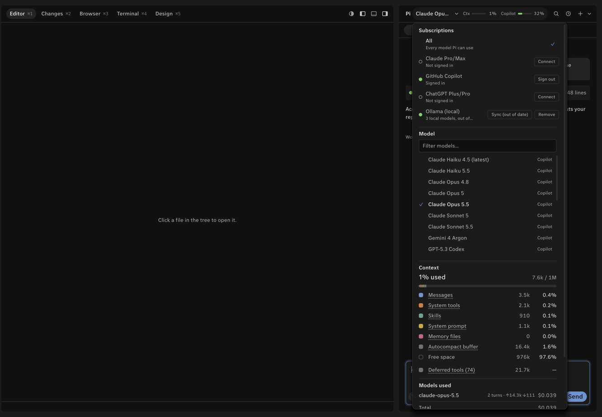 | 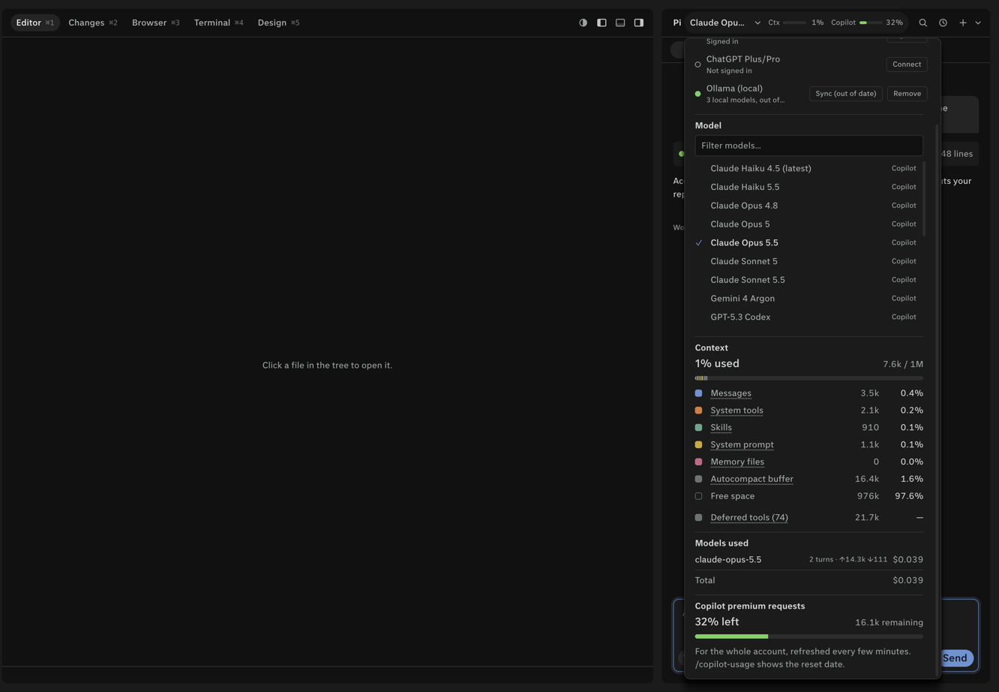 |

**Extras**
- **Todos**: a collapsible panel above the input follows Pi's todo tool.
- **Mermaid**: ```` ```mermaid ```` blocks are drawn as diagrams in the app's colours (hover for a Code toggle).
- **Copy**: hover an answer to copy it as Markdown.
- **Find in chat**: ⌘F (Enter / Shift+Enter, Esc closes).
- **Notifications**: a system notification and Dock badge (taskbar badge on Windows) when Pi finishes or asks something while the window is in the background; a toast when it happens in another tab. Toggle with "Notifications" in the palette.

| Todos | Mermaid |
|---|---|
| 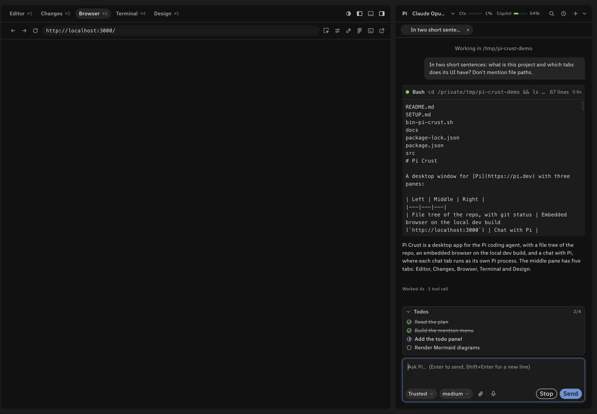 | 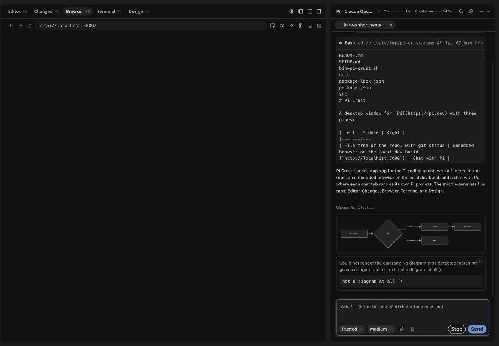 |

## Views

A view decides which features you see. Switch with the **All | Dev | Design** control in the tab bar, the palette (*View: Dev*), or ⌃⌘1 / ⌃⌘2 / ⌃⌘3. The choice is remembered.

- **All**: everything.
- **Dev**: Editor, Changes, Viewer, Terminal. No tweak, annotate and Figma tools, story bar or screenshots timeline.
- **Design**: Viewer, Design, Changes. No Editor, Terminal or devtools; the files and commits pane starts closed.

Each view remembers its own panel layout. ⌘1…⌘5 number the tabs of the current view. If something opens a hidden tab (say *Open in Editor* from a diff), it shows until you leave it.

## Middle tabs

Default order: **Editor, Changes, Viewer, Terminal, Design**. Drag a tab to move it (or ⌥⇧← / ⌥⇧→); ⌘1…⌘5 follow the order.

### Editor
Monaco, the editor of VS Code: syntax highlighting, multi-cursor, find/replace, command palette (F1), minimap.
- Click a file in the tree to open it. One tab per file; ● marks unsaved changes.
- ⌘S saves, ⌥⌘S saves all, middle-click or × closes a tab.
- ⌘L (or right-click → *Add Selection to Chat*) adds the selection as a pill in the chat.
- When Pi changes a file on disk, a clean tab reloads; a tab with unsaved changes asks.
- Open tabs and unsaved text are kept per repo, also across a restart.

### Changes
- Changed files with `NEW` / `MOD` / `STG` / `ADD` / `DEL` / `REN` badges, a filter for *files this chat changed*, and ↺ to discard a file.
- An **editable diff** (HEAD left, working tree right): inline or *Side by side*, *Copy*, *Open in Editor*, *Save* (⌘S), ⌘L adds selected lines to the chat. A file open in the Editor shares its unsaved text. Deleted, binary or very large files fall back to a text diff.
- **Git bar**: Commit, Commit + Push, Push, and **Create PR with Pi**, which asks Pi to open the PR following the repo's own conventions (it becomes **Open PR #N** once one exists). Committing or pushing on `main` asks first.

### Viewer
Your local dev build (default `http://localhost:3000`). The self-signed certificate is accepted for localhost only. Localhost links from the chat open here; other links open in your system browser. ⌘R reloads the page. The browser bar has the tools from [Working in the browser](#working-in-the-browser).

### Mendix apps
When the repo holds a Mendix project (an `.mpr`, or an `.mpk` when there is no `.mpr`, up to 2 folders deep, skipping `node_modules`, `deployment` and similar), a **Mendix bar** shows under the Viewer's address bar. **Start** builds the project with a pinned [docker-mendix-buildpack](https://github.com/mendix/docker-mendix-buildpack) (`v6.0.8`), runs it next to a Postgres container for this repo, waits until it answers and opens it in the Viewer tab. The same actions are in the palette as *Mendix: …*.

- **Needs:** Docker Desktop running, `git` and Python 3.8 or later on the host (**Windows isn't supported yet**: the buildpack needs Python and Docker inside WSL, so Start stops with a message there). The app must be Mendix 8 or later; older projects get a clear error.
- **First build** takes minutes (base images, mxbuild download). The bar shows the step and a clock; **Stop** cancels. Cancelling sends SIGINT to the build, then SIGKILL after 5 s, and removes leftover `mendix-buildpack:mxbuild-*` containers. `build.py` calls `docker`, so the docker found by Pi Crust is put first on its `PATH`; if you use podman, make a `docker` alias for it or Docker Desktop's CLI will be used. The buildpack is cloned once to the app data folder (`mendix/buildpack/<tag>`).
- **Apple Silicon:** the buildpack says ARM64 isn't fully supported. Mendix 9.22 and later build natively; older versions build under amd64 emulation (slow; turn on Rosetta for x86_64/amd64 emulation in Docker Desktop).
- **Buttons:** Start, Stop, Rebuild (compile again), Open, **Logs** (drawer with build and app output), **Admin** (copies the `MxAdmin` password), and under **⋯** *Reset database…* and *Follow logs in Terminal*.
- **Admin password:** made once per repo (and a separate database password), kept in `settings.json`, never put on a command line or in the log. Log in as `MxAdmin`.
- **Docker objects**, named `pcm-<repo>-<hash>-…`: containers `-app` and `-db`, network `-net`, volume `-pgdata`, image `-app:latest`. Postgres keeps its data in the volume and keeps running after you quit; the app container is stopped on quit (setting `mendixStopOnQuit`).
- **Remove everything by hand:** `docker rm -f <key>-app <key>-db; docker volume rm <key>-pgdata; docker network rm <key>-net; docker rmi <key>-app:latest` (find them with `docker ps -a --filter label=dev.picrust.mendix`).

### Terminal
A login shell in the repo (PowerShell on Windows), using the repo's Node (`.nvmrc`). While a command runs (dev server, Storybook, …) the bar shows it with a green dot and its running time, and the tab gets a timer badge.

## Design tab

⌘5. The view button at the top right of the tab bar (⌃⌘1/2/3) switches between the All, Dev and Design views.

**Compare.** *Get Figma selection* loads the frame selected in Figma desktop; *Capture build* captures the Viewer tab at the frame's size, the current viewport or a picked element. View them as **Slider**, **Onion skin**, **Side by side** or **Diff** (pixel heatmap, "92.4 % match", threshold slider). *Send to chat* adds the images with a note.

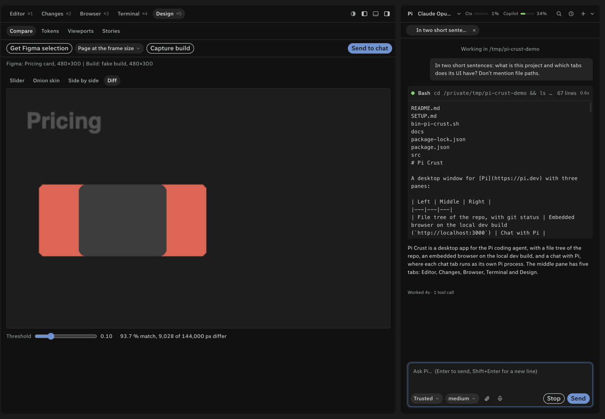

**Tokens.** The page's tokens as colour swatches (with contrast), spacing bars, radii and type specimens. **Compare with Figma variables** shows ✓ same, ≠ different, only in code, only in Figma. The search field finds a token by name or value (`#1a73e8`, `rgb(26,115,232)`, `12px`, `0.75rem`): exact matches first, then the nearest few with their delta. Click a token to copy its name, ⌥-click for `var(--name)` or the theme path; ⌘K › Find token… jumps to the field. Pages without tokens can use a JSON file via `designTokensFile` (see [Configuration](#configuration)).

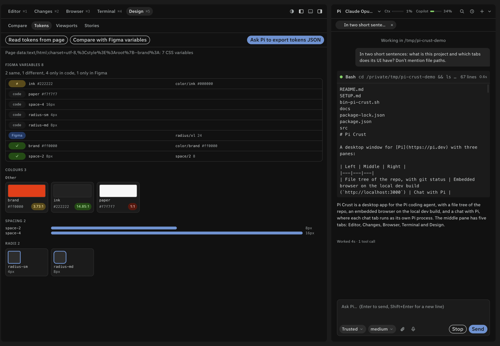

**Viewports.** Your app at **Mobile** 390×844, **Tablet** 820×1180 and **Desktop** 1440×900, in **Light**, **Dark** or **Both**. Snapshots refresh shortly after files change. Click a tile to enlarge it or send it to the chat.

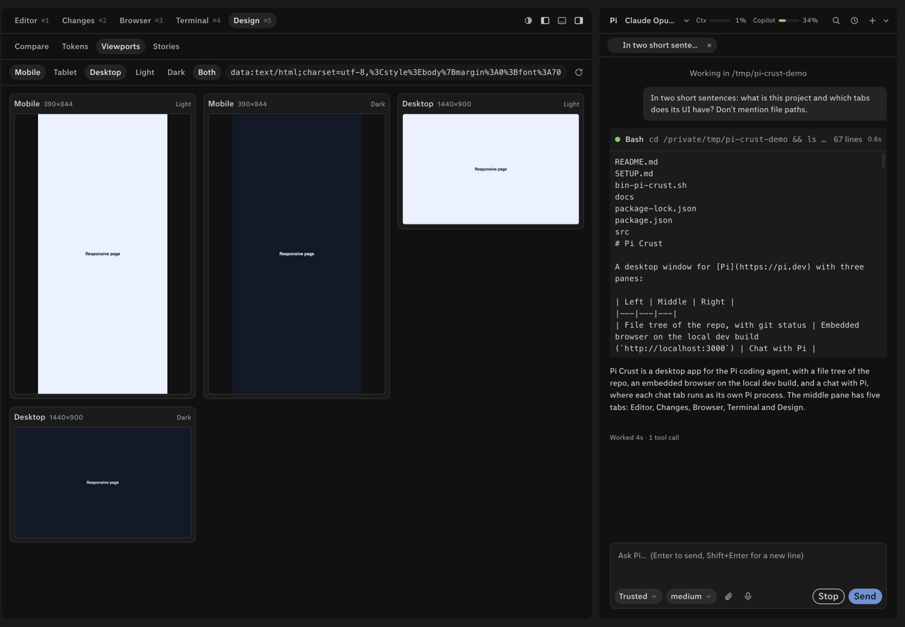

**Stories.** The project's Storybook as a gallery grouped by title, with a filter.
- Storybook is found automatically (`localhost:6006`, the ports of the repo's `storybook` scripts, or `storybookUrl`). If it isn't running, **Start Storybook** runs it in the Terminal tab.
- **Click a story to work on it**: the Viewer tab opens just that story, so the picker, Tweak and Annotate see only that component. A story bar offers sibling stories, **Component**, **Stories file**, **Figma**, **Storybook UI** and **Work on with Pi** (adds a thumbnail and a `<storybook-story>` block to the input).
- **All / In Figma**: *In Figma* shows only stories whose component is in the Figma file where the figma-console **Desktop Bridge** plugin runs, with a badge per tile, plus a list of Figma components without a story.


## Working in the browser

The buttons in the browser bar (also in the palette):

| Tool | How | What you get |
|---|---|---|
| **Element picker** | 🎯 or ⌘⇧C. Hover, click to pick, Shift+click for more, Esc to finish. | A `<browser-element>` block in the input: selector, React component chain, source files, text, key styles, HTML and a screenshot. Nothing is sent. |
| **Token check** | Automatic while picking | Chips in the hover label: ✓ theme token, ✗ hard-coded. The block gets the nearest token for each hard-coded value. |
| **Figma picker** | Figma button or ⌘⇧F | The layer selected in Figma desktop as a `Figma: <name>` pill, with the file link, node id and which properties are bound to variables. |
| **Tweak** | Sliders button | A live panel for padding, gap, radius, font size, colour and background, snapping to the page's tokens (hold ⌥ for free values). **Apply with Pi** asks Pi to make the change in code. |
| **Light/dark** | Half-circle button, or palette *Viewer: toggle light/dark* | Cycles Auto (follows the app) → Light → Dark for the dev browser only (`prefers-color-scheme`). Remembered across restarts. |
| **Element states** | Checkmark button | A row to force `:hover`, `:focus`, `:focus-visible`, `:active` or disabled on the last picked/tweaked element (or its button/link/input ancestor). Besides the CSS state it really hovers and focuses the element, so JS states like MUI's `.Mui-focused` / `.Mui-focusVisible` follow; disabled also adds `.Mui-disabled` on MUI components. Moving the mouse into the page undoes hover. Cleared on navigation or with **Clear**. |
| **Annotate** | Pen button | A drawing overlay (pen P, arrow A, box B, text T, undo ⌘Z) on a screenshot; **Add to chat** attaches the marked-up image. |

The Figma picker and Design compare talk to the Figma desktop MCP server (`http://127.0.0.1:3845/mcp`), so Figma desktop must be open with that server on. The MCP server doesn't expose the file key: paste a `figma.com/design/<key>/<name>` link into the chat input once to set it.

| Tweak | Annotate |
|---|---|
| 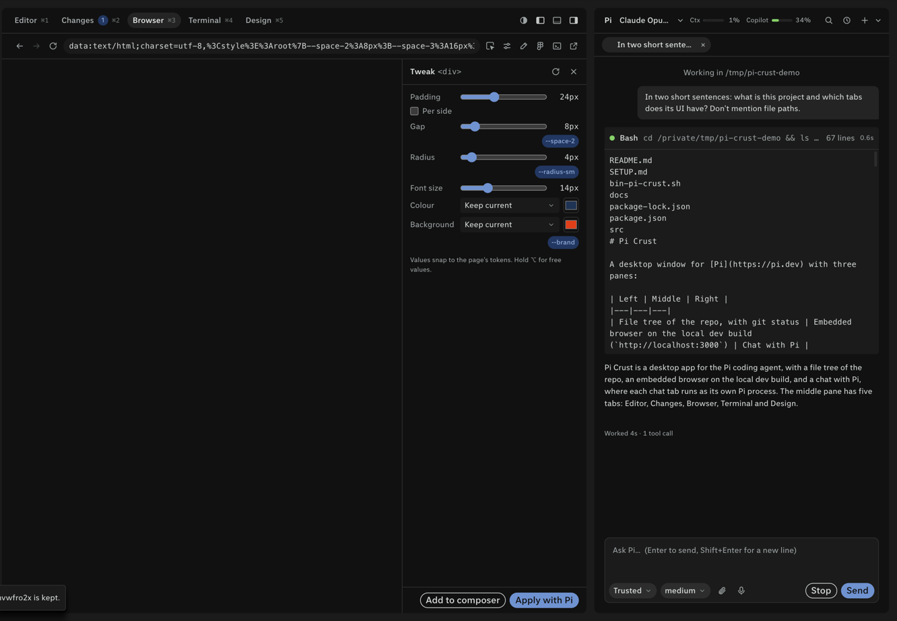 | 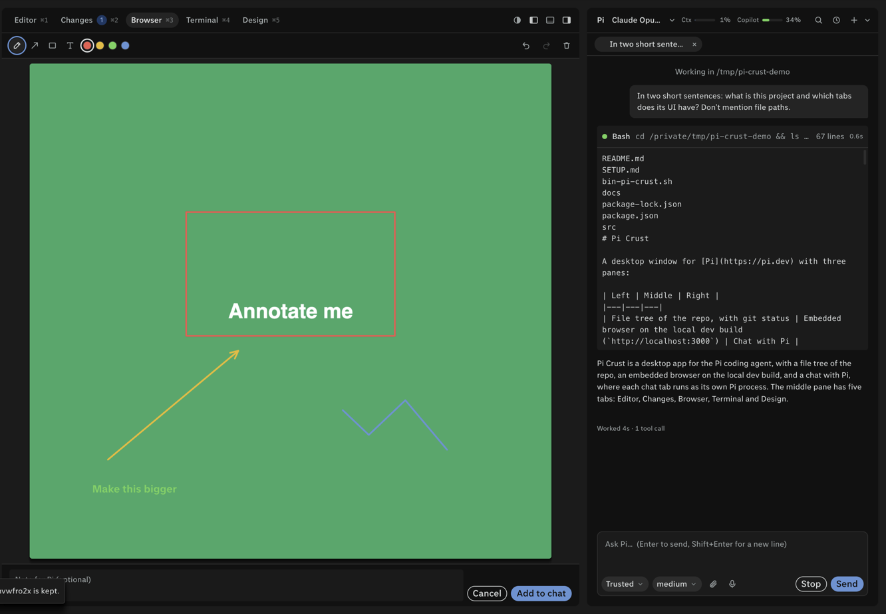 |

## History: checkpoints, rewind and screenshots

**Checkpoints.** Each message you send snapshots the working files (tracked and untracked, not git-ignored) just before it goes to Pi.
- Hover one of your messages: the **pencil** forks the conversation to before it and puts the text back in the input; the **rewind arrow** lists the file changes and restores code and/or conversation, with *Undo restore*.
- `/rewind` and the palette do the same.
- Snapshots are commits under `refs/pi-crust/cp/*`, built with a temporary index, so your index, HEAD, branches and stash are never touched. The last 300 are kept. Untracked files end up in `.git` objects until pruned; a restore never overwrites ignored files.

**Before/after screenshots.** When a turn that edited files ends, the Viewer tab is captured before and after. The chat gets a *Before / after* card (slider, overlay, side by side), and a **Screenshots** strip under the chat tabs lists every turn, with *Show in chat* and *Rewind to before this turn*. Toggle in the palette.

| Rewind | Screenshot timeline |
|---|---|
| 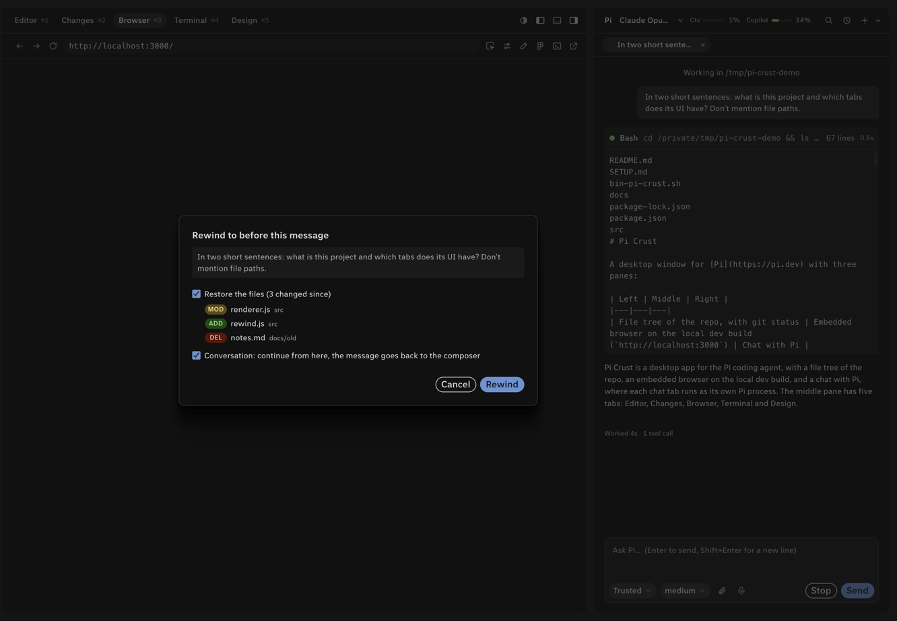 | 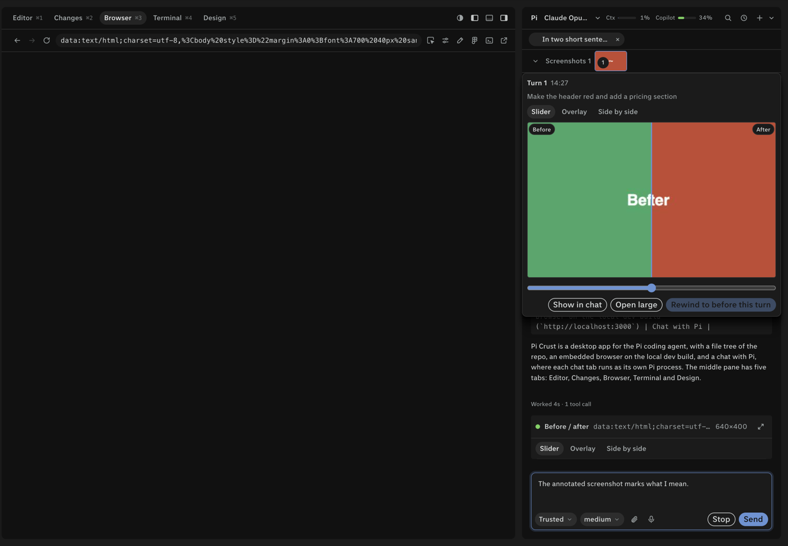 |

## Worktree per chat

The chevron next to **＋** (or *New chat in worktree…*) asks for a branch name (default `pi/<yyyymmdd-hhmm>`) and runs `git worktree add -b <branch>` in the app's data folder, never inside your checkout. Pi in that chat works there.
- The tab gets a branch badge. While it is open, Changes, the git bar and checkpoints work on the worktree, and a banner says so. The file tree, editor and commit graph keep showing your main checkout.
- Worktree chats show up in Earlier chats and reopen in their worktree after a restart.
- Closing the tab asks whether to remove the worktree (the branch is always kept).
- A new worktree has no `node_modules`; the toast offers *Install dependencies*.

## Keyboard shortcuts

On Windows, ⌘ and ⌃ mean Ctrl and ⌥ means Alt. Ctrl+W does not close the window there.

| Keys | Action |
|---|---|
| ⌘K | Command palette: files, skills, prompt templates, extension and slash commands, app actions |
| ⌘N | New chat |
| ⌘J | Earlier chats |
| ⌘⇧[ / ⌘⇧], Ctrl+Tab | Previous / next chat tab |
| ⌘1 … ⌘5 | Middle tabs (of the current view) |
| ⌃⌘1 / ⌃⌘2 / ⌃⌘3 | View: All / Dev / Design |
| ⌘F | Find in chat |
| ⌘⇧C | Element picker |
| ⌘⇧F | Figma picker |
| ⌘⇧Space | Voice input |
| ⌘L | Add editor / diff selection to the chat |
| ⌘S / ⌥⌘S | Save / save all |
| ⌘R | Reload the Viewer tab |

**File tree**: click (or Enter) opens a file in the Editor, double-click mentions it in the chat, ⌘-click opens it in VS Code. Drag the pane borders to resize; the layout is remembered.

**Slash commands** typed in the chat: `/reload`, `/new`, `/compact`, `/model`, `/fork`, `/thinking`, `/rewind`, … (terminal-only ones point you to the Terminal tab).

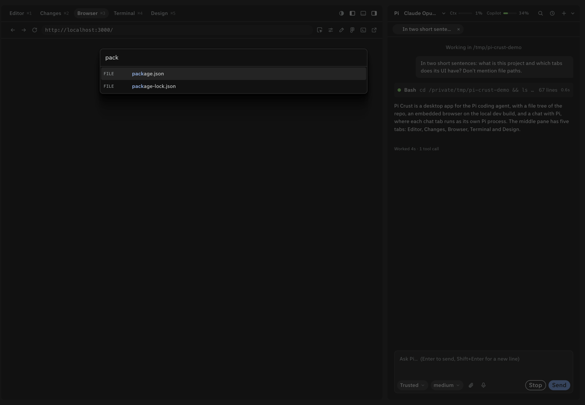

## Remote from your phone

Chat with Pi from your phone, in a small web app that Pi Crust serves itself. You choose which chats the phone can use. In the phone you can see those chats, read them live, send prompts, stop a run, answer Pi's questions, start a new chat and restart one that stopped. You can't use the terminal, the files or git from the phone.

Turn it on with *Remote access…* in the command palette, `/remote`, or the 📱 button in the chat header. The panel walks you through the setup.

- **Sharing is per chat.** Open a chat and turn on *Use this chat from your phone* in the 📱 menu (or in the palette). Only shared chats appear on the phone; the rest stay invisible and can't be reached. Shared chats get a small phone icon on their tab, and *Remote access…* lists them with a *Stop sharing* button. Sharing a chat turns Remote on. A chat you start from the phone is shared automatically. Sharing is remembered per session, so it survives a restart of Pi Crust, and closing a chat ends it.

- **Tailscale (recommended).** Install Tailscale on the computer and the phone and sign in to the same tailnet. In the Tailscale admin console, on the DNS page, turn on MagicDNS and HTTPS certificates. Then press *Set up Tailscale Serve* in the panel. You get an `https://` address that only your tailnet can reach. Pi Crust refuses to use a port that has Tailscale Funnel on or already serves something else, and it stops Remote if Funnel is turned on later. See [SETUP.md](SETUP.md#remote-access-with-tailscale-optional).
- **Wi-Fi (LAN).** Plain `http://` on your private network. Traffic isn't encrypted and there are no notifications, so use it only on a network you trust. If you have several networks (VPN, virtual machines), pick the right one in the panel. A phone paired over Wi-Fi only works in Wi-Fi mode, and that pairing lasts 30 days.
- **Pairing.** Press *Pair a phone*, then scan the QR code or type the code. A code works once and expires after 5 minutes. In Tailscale mode, pair only after Serve is set up. On iPhone, add the page to your Home Screen first and pair inside the app, because the installed app keeps its own login.
- **Notifications.** With Tailscale (https) the phone can notify you when Pi finishes or asks something. Turn them on in the phone app. The panel has a *Show message text in notifications* option; switch it off and notifications only say that Pi finished or needs you. On iPhone this needs iOS 16.4 or later and the page added to the Home Screen.
- **Security.** Each phone gets its own login token, stored hashed on the computer and kept in the phone app's local storage (not in a cookie, so it is never sent to other sites or ports on the same address). *Unpair* in the panel cuts a phone off at once. The server listens on `127.0.0.1` (Tailscale) or one private Wi-Fi address (LAN), never on the public internet. Every request is checked for the right host, origin and login.
- **Staying awake.** Pi Crust keeps the computer from sleeping while a phone is connected or a chat is working, but closing a laptop lid still puts it to sleep.
- **Windows.** Closing the window quits the app, and that turns Remote off.
- **Where it's stored.** `remote.json` in the app's data folder (paired phones, shared sessions, port, mode, push keys). Delete a phone in the panel instead of editing it.

## Configuration

**Environment variables**

| Variable | Default |
|---|---|
| `PI_CRUST_CWD` | unset: the repo picker is shown |
| `PI_CRUST_URL` | `http://localhost:3000/` |
| `PI_CRUST_FIGMA_FILE_KEY` | unset; `figmaFileKey` in `settings.json` (set by pasting a Figma link) wins |
| `PI_CRUST_PI` | found automatically: nvm's default Node, then other nvm versions, then Homebrew / `~/.local/bin` |

**`settings.json`** (in the app's data folder, `~/Library/Application Support/pi-crust/`; on Windows `%APPDATA%\pi-crust`)

| Key | Purpose |
|---|---|
| `figmaFileKey`, `figmaFileName` | The Figma file for the Figma picker (set by pasting a link) |
| `storybookUrl` | Storybook address; empty means auto-detect |
| `designTokensFile` | JSON with `colors`, `spacing`, `radii`, `typography`, relative to the repo |
| `toolCallCheckIn` | Ask "Keep going?" after this many tool calls in one run (default 40, `0` = off). Applies to chats started afterwards |
| `mendix` | Per-repo Mendix passwords and port; written by the app |
| `mendixStopOnQuit` | Stop the Mendix app container when Pi Crust quits (default `true`; Postgres keeps running) |
| `mendixPostgresImage` | Postgres image for the Mendix database (default `postgres:14-alpine`) |
| `mendixStartTimeoutSec` | How long to wait for the Mendix app to answer (default 300) |
| `figmaConsoleMcp` | figma-console MCP server config, if not taken from `~/.pi/agent/mcp.json` |

Pi runs on the Node it was installed with, whatever the repo's `.nvmrc` says; the terminal uses the repo's Node.

## Development

```bash
npm test
```

Runs every `src/*.test.js` and `scripts/*.test.js`; these are gitignored and stay local (pure logic: durations, checkpoints, pixel diff, tokens, Storybook, worktrees, voice, the secret check, …).

**Secret check.** `npm install` turns on the git hooks in `.githooks` (`core.hooksPath`). Every commit and every push is checked by `scripts/check-secrets.js`: no `.env`, `auth.json`, SSH keys, certificates or `.npmrc`, and no API keys or tokens (Anthropic, OpenAI, GitHub, AWS, Google, Slack, Figma, npm, Tailscale), private keys, JWTs, passwords in URLs or hard-coded `password = "…"` values in added lines. In test files (`*.test.js`, `*.spec.*`, `test/`, `tests/`, `__tests__/`) the generic URL-password and `password = "…"` checks are skipped, since those hold made-up values; real token formats are still caught there. When something is found, nothing is committed or pushed and the report shows the file, line and a masked sample. The push check also catches commits made with `--no-verify`. A false positive gets the comment `secret-check: allow` on that line. `npm run check-secrets` checks every tracked file; `node scripts/check-secrets.js --history` checks every commit.

```bash
npm run selftest
```

Opens the app, sends one prompt, answers Pi's dialogs with their first option, visits every tab and feature, saves a screenshot of each to `out/` and quits. It opens this repo unless `PI_CRUST_CWD` or a path argument says otherwise; `PI_CRUST_SELFTEST_PROMPT` sets the prompt. UI console errors and `MISMATCH` lines point at problems. The screenshots in `docs/screenshots/` come from a selftest run on a clean clone.

To test one feature, name it: `npm run selftest -- timeline` (or several: `npm run selftest -- timeline annotate`; same as `PI_CRUST_SELFTEST_ONLY=timeline,annotate`). It still sends the prompt, then runs only the steps registered by those feature scripts (named after the file, e.g. `chat-find`, `design-tokens`, `worktree`; `durations` for the turn timers; `core` for the built-in tour of tabs, editor, palette, layout and zoom). An unknown name prints a `MISMATCH` line listing the known ones.

After changing `node-pty` or Electron, rebuild the native module: `npx electron-rebuild -f -w node-pty` (not on Windows, where `node-pty` uses prebuilt binaries).

To build the Windows installer, run `npm run dist:win`. It writes `dist\Pi Crust Setup <version>.exe` (see [SETUP.md](SETUP.md#install-as-an-app)). On a Mac, `npm run dist:mac` writes `dist/Pi Crust-<version>-<arch>.dmg` (see [SETUP.md](SETUP.md#install-as-an-app-macos)).

### Files

Main process (`*-main.js` modules export `register(ctx)` and get one line in `main.js`):

| File | Role |
|---|---|
| `main.js` | Window, one Pi subprocess per chat (strict JSONL), file tree, git, embedded browser |
| `preload.js` | The narrow bridge to the UI, one namespace per feature |
| `checkpoints-main.js` | Checkpoints and restore |
| `snap-main.js` | Screenshots of the dev browser and offscreen pages, shot storage |
| `watch-tree.js` | Recursive folder watching; on Linux a pruned, asynchronous walk instead of Node's full one |
| `design-main.js`, `figma-mcp.js` | Figma desktop MCP: selection, screenshots, variables |
| `figma-bridge-main.js`, `figma-match.js` | figma-console Desktop Bridge server, matching components to stories |
| `storybook-main.js` | Finding, starting and reading Storybook |
| `mendix-main.js`, `mendix-logic.js` | Running a Mendix app: Docker build and run, state machine; the pure parts (detection, names, docker arguments, errors) |
| `worktree-main.js` | Git worktrees per chat |
| `voice-main.js`, `voice.js` | Local transcription with whisper-cli |
| `update-main.js` | Updating Pi Crust itself from its git clone (runs `scripts/update.js`; the installed Windows app via `scripts/dist-win.js` and its installer) |
| `remote-main.js`, `remote-server.js` | Remote access: lifecycle, Tailscale, push; the HTTP server for the phone |
| `remote-auth.js`, `remote-routes.js`, `remote-share.js`, `remote-state.js`, `remote-tailscale.js`, `webpush.js` | Remote's pure parts: pairing and tokens, routes and header checks, chat state, Tailscale parsing, Web Push |
| `remote/` | The phone web app (served by the server above) |
| `picker.js` | Element picker and token check injected into the page |

UI (all in `src/`):

| File | Role |
|---|---|
| `renderer.js` | Chat, file tree, browser bar, dialogs, hook bus (`onCrust` / `emitCrust`) |
| `changes.js`, `changes-editor.js` | Tabs, Changes view with the Monaco diff, git bar |
| `editor.js`, `terminal.js` | Editor (Monaco) and Terminal (xterm.js + node-pty) tabs |
| `context-panel.js`, `pi-extension/crust-context.ts` | Model & usage pill and popover |
| `pi-extension/advisor.ts`, `advisor-main.js` | Anthropic advisor tool in each chat's Pi; the pointer for subagents and terminal Pi |
| `sessions.js`, `slash.js`, `palette.js` | Earlier chats, slash commands, command palette and shortcuts |
| `subagents.js`, `duration.js` | Live subagent view, durations and progress |
| `notify.js`, `chat-find.js`, `thinking.js`, `mention-menu.js`, `todo-panel.js`, `mermaid-render.js`, `voice-ui.js` | Chat extras |
| `rewind.js`, `turn-shots.js`, `timeline.js`, `compare-view.js` | Rewind, before/after shots, timeline, compare widget |
| `design*.js`, `pixel-diff.js`, `page-tokens.js`, `token-match.js`, `annotate.js`, `tweak.js` | Design tab, annotate overlay, tweak panel |
| `worktree.js` | Worktree chats in the UI |
| `mendix.js` | Mendix bar, log drawer and palette commands in the Viewer tab |
| `remote-panel.js` | Remote access panel and header indicator |
| `app-update.js` | The Pi Crust update card in the notifications above the chat |
| `index.html`, `styles.css` | Layout and styles |

Design notes: [docs/visual-features-plan.md](docs/visual-features-plan.md), [docs/figma-pane-plan.md](docs/figma-pane-plan.md).
